# ☀️ PV System Modeling & Advanced MPPT Implementation

> **Team Project:** Solar-Powered EV Charging Station with BESS (8-member team) — *documentation by Abd El-Rhman Muhammad Saad*  
> **Academic Institution:** Faculty of Engineering, Alexandria University (Class of 2026)  
> **Department:** Electrical Power and Machines Engineering  
> **Core Focus:** Single-Diode Photovoltaic Modeling, Operational Perturb & Observe (P&O), Embedded C Firmware & Partial Shading Sweep

---

This repository directory contains the physical modeling of Photovoltaic (PV) array characteristics and the progressive development of Maximum Power Point Tracking (MPPT) algorithms. The investigation progresses from baseline single-diode analytical modeling to the primary operational **Perturb & Observe (P&O)** tracking controller, supplemented by an analytical **Incremental Conductance (Inc. Cond.)** benchmark, and culminates in a supervisory **Global Scanning MPPT (Forced Sweep)** designed to eliminate local-maximum trapping under Partial Shading Conditions (PSC).

---

## 📌 Executive Summary & Methodological Distinction

To establish full clarity regarding theoretical investigation versus physical hardware deployment:

* **Primary Operational Algorithm (P&O):** **Perturb and Observe** was selected as the **sole active tracking algorithm** implemented in the physical hardware prototypes and the integrated closed-loop microgrid. Due to its computational simplicity, noise immunity, and deterministic execution without division-by-zero singularities, it is realized both in Simulink (`MPPT_PO1.slx`) and embedded C firmware (`mppt_po.c`).
* **Comparative Analytical Benchmark (Inc. Cond.):** The **Incremental Conductance** algorithm (`Incremental_conductance.slx`) was evaluated **strictly in simulation** as a comparative benchmark to contrast dynamic convergence speeds and steady-state tracking oscillations against classical P&O.
* **Partial Shading Supervisory Layer (Global MPPT):** A state-machine-driven voltage sweep model (`Central_Boost_MPPT_with_check.slx`) developed to overcome multiple-peak P-V curves resulting from non-uniform solar irradiance.

### Core File Manifest

| File Name | Domain | Primary Purpose |
| :--- | :--- | :--- |
| **`pv_curves.slx`** | Simulation Model | Single-diode analytical model extracting non-linear I-V and P-V characteristic curves |
| **`MPPT_PO1.slx`** | Primary Control | Dedicated Simulink model of the active Perturb & Observe (P&O) tracking loop |
| **`mppt_po.c`** | Embedded Firmware | Floating-point ANSI C implementation of P&O logic for microcontroller deployment |
| **`Incremental_conductance.slx`** | Simulation Benchmark | Comparative simulation assessing dI/dV + I/V = 0 tracking dynamics |
| **`Central_Boost_MPPT_with_check.slx`** | Advanced Control | Global forced voltage sweep supervisory loop mitigating partial shading |

---

## 1️⃣ PV Array Modeling & Physical Parameters (`pv_curves.slx`)

Rather than treating the solar generator as an idealized DC source, the photovoltaic generator is modeled using the five-parameter single-diode equivalent circuit ($R_s - R_p$ topology):

$$I_{\text{pv}} = I_{\text{ph}} - I_0 \left[ \exp\left( \frac{q (V_{\text{pv}} + I_{\text{pv}} R_s)}{a k T N_s} \right) - 1 \right] - \frac{V_{\text{pv}} + I_{\text{pv}} R_s}{R_p}$$

Where:
* $I_{\text{ph}}$ is the light-generated photocurrent directly proportional to solar irradiance.
* $I_0$ is the dark saturation diode current.
* $R_s$ models internal semiconductor bulk and contact resistances.
* $R_p$ models p-n junction leakage current.

### Module Analytical Parameters & Physical Baseline (`pv_curves.slx`)

The analytical parameters below configure the single-diode simulation model (`pv_curves.slx`) at nominal cell operating temperature ($1000\text{ W/m}^2$, $318\text{ K} / 45^\circ\text{C}$):

> **Note on Model Scope vs. Full-Scale Utility Array:** The simulation model `pv_curves.slx` characterizes a **single standalone PV module (~95 W)** to extract non-linear I-V and P-V characteristic curves and assess temperature sensitivity. In the integrated microgrid simulation (Modules 2 and 6), a full-scale utility array of 12 series-parallel modules rated at 710 W nominal each (8.52 kW total nominal capacity) is deployed to supply the common 600.0 V DC bus.

| Parameter | Symbol | Value | Physical Significance / Operational Context |
| :--- | :---: | :---: | :--- |
| **Nominal Irradiance** | $G_{\text{ref}}$ | $1000\text{ W/m}^2$ | Solar insolation benchmark |
| **Cell Temperature** | $T_{\text{cell}}$ | $318\text{ K}\ (45^\circ\text{C})$ | Operational study temperature (NOCT; not $25^\circ\text{C}$ STC) |
| **Open-Circuit Voltage** | $V_{\text{oc}}$ | $22.94\text{ V}$ | Single module open-circuit voltage |
| **Short-Circuit Current** | $I_{\text{sc}}$ | $5.56\text{ A}$ | Single module short-circuit current limit |
| **Voltage at MPP** | $V_{\text{mp}}$ | $\approx 18.7\text{ V}$ | Terminal voltage at maximum power point (read from curve) |
| **Current at MPP** | $I_{\text{mp}}$ | $\approx 5.1\text{ A}$ | Terminal current at maximum power point (read from curve) |
| **Maximum Power Point** | $P_{\text{max}}$ | $\approx 95\text{ W}$ | Peak power: $V_{\text{mp}} \cdot I_{\text{mp}} \approx 18.7\text{ V} \times 5.1\text{ A} \approx 95.4\text{ W}$ |
| **Series Cells per Module** | $N_s$ | $36$ | Monocrystalline series cell count |
| **Silicon Bandgap Energy** | $E_g$ | $1.12\text{ eV}$ | Silicon crystal potential barrier |
| **Series Resistance** | $R_s$ | $0.145\ \Omega$ | Ohmic dissipation in cell fingers and bulk silicon |
| **Parallel Resistance** | $R_p$ | $300\ \Omega$ | Shunt resistance across p-n junction |
| **Temperature Coefficient** | $K_i$ | $0.0021\text{ A/K}$ | Short-circuit current thermal drift coefficient |
| **Diode Ideality Factor** | $a$ | $1.3$ | Single-diode junction carrier recombination factor |

### Analytical Curve Extraction Model

The Simulink model numerically solves the implicit transcendental I-V equation to synthesize the non-linear operational locus:

<p align="center">
  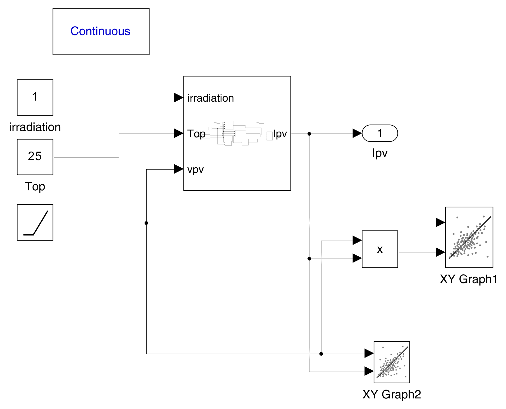
</p>

### Non-Linear Characteristic Curves (STC 1000 W/m²)

The resulting characteristic curves confirm exact alignment with single-diode physics, displaying the maximum power knee at $V_{\text{mp}} \approx 18.7\text{ V}$, $I_{\text{mp}} \approx 5.1\text{ A}$, and peak power $P_{\text{max}} \approx 95\text{ W}$ ($V_{\text{oc}} = 22.94\text{ V}$, $I_{\text{sc}} = 5.56\text{ A}$):

#### P-V Characteristic Power Curve
<p align="center">
  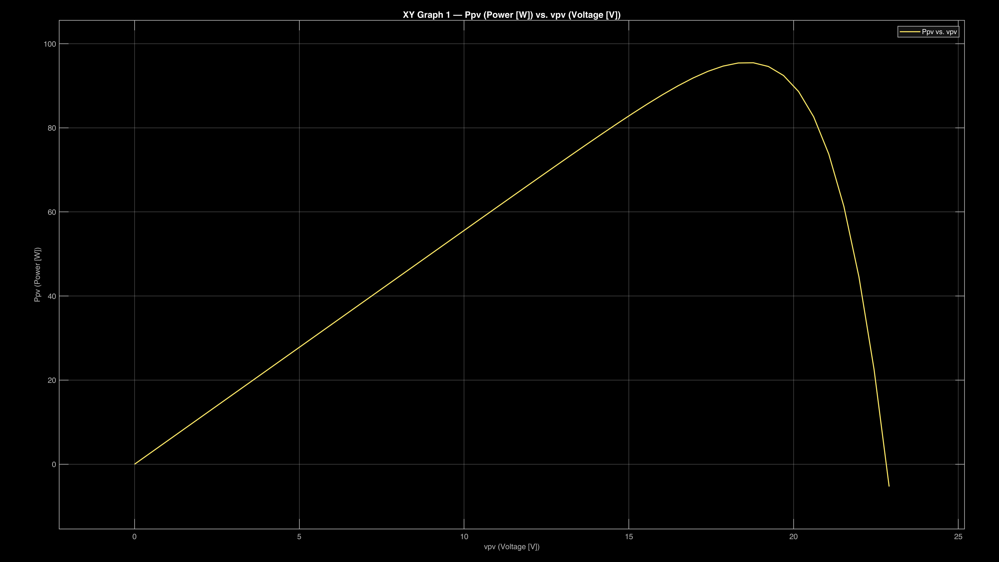
</p>

#### I-V Characteristic Current Curve
<p align="center">
  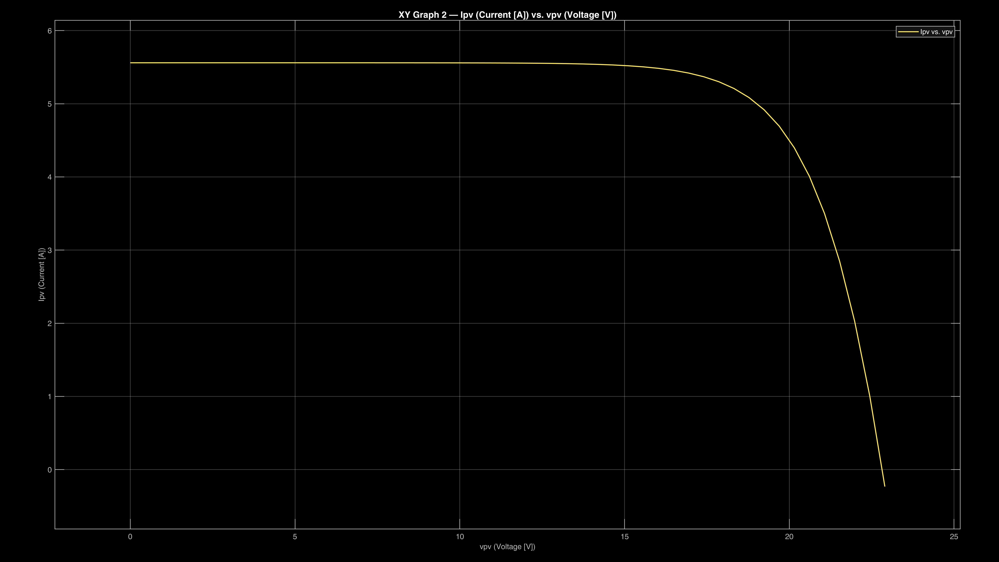
</p>

---

## 2️⃣ Primary Deployed Control Strategy: Perturb & Observe (P&O)

The primary MPPT algorithm selected and deployed across the power electronic stages is the **Perturb and Observe (P&O)** method. The controller continuously samples terminal voltage $V(k)$ and current $I(k)$, computes instantaneous power $P(k) = V(k) \cdot I(k)$, and evaluates directional gradients:

$$\Delta P = P(k) - P(k-1), \quad \Delta V = V(k) - V(k-1)$$

The control law modulates the converter duty cycle according to:

$$D(k) = D(k-1) + \text{sign}(\Delta P \cdot \Delta V) \cdot \Delta D$$

Where step size $\Delta D = 0.0005$ guarantees minimal limit-cycle oscillation around the true MPP.

### Algorithmic Decision Flowchart

<p align="center">
  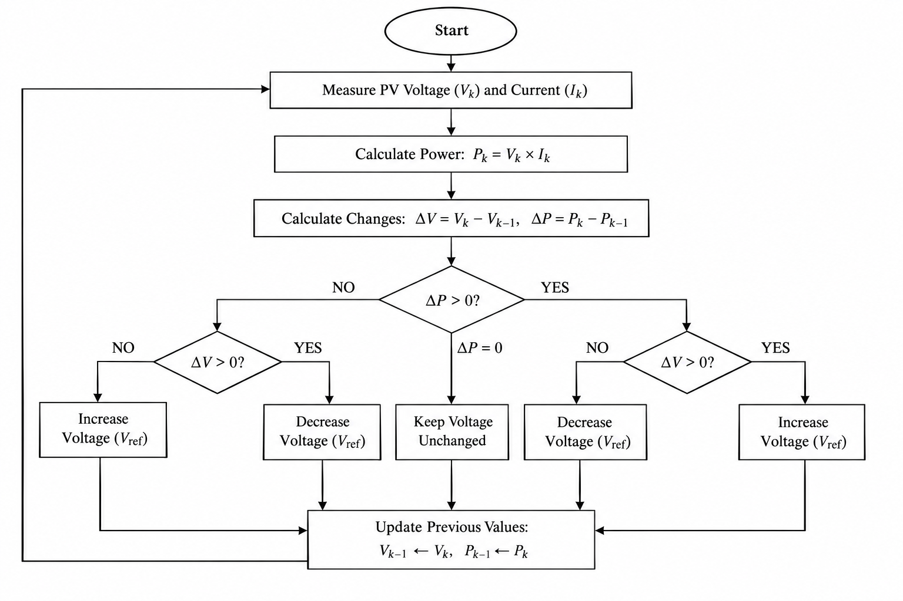
</p>

### Simulink Logic Implementation (`MPPT_PO1.slx`)

The internal subsystem architecture implements discrete delay units ($z^{-1}$), gradient difference blocks, multiplication, and a saturation limiter to prevent converter runaway:

<p align="center">
  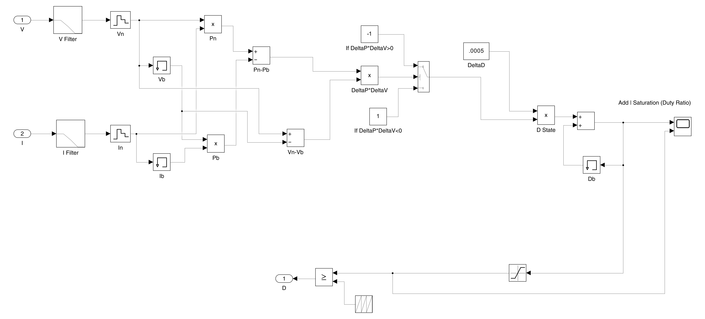
</p>

### Closed-Loop Duty Ratio & Convergence Tracking

The scope capture below illustrates the smooth convergence of the duty cycle toward the optimal operating ratio with active saturation limiting ($D_{\text{min}} = 0.02, D_{\text{max}} = 0.92$):

<p align="center">
  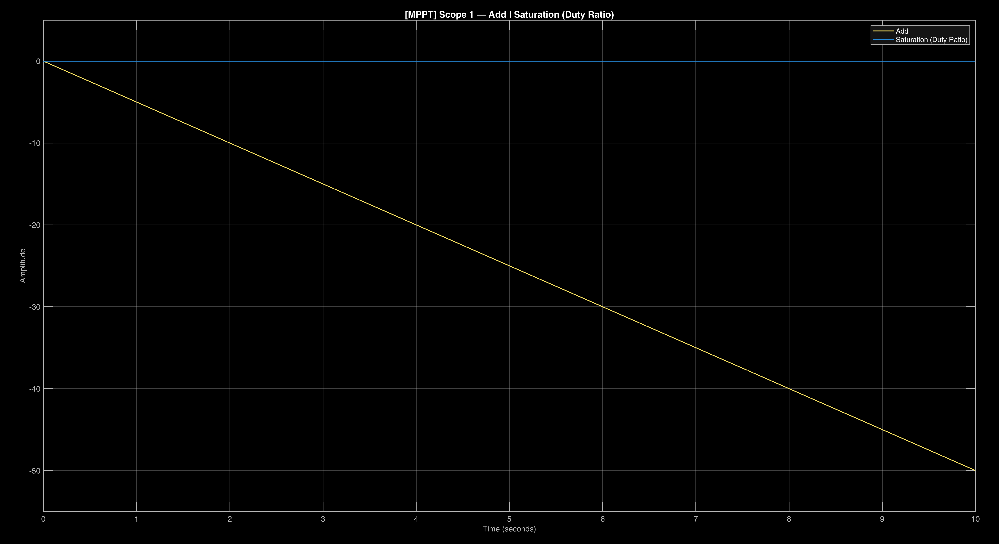
</p>

### Embedded C Firmware Implementation (`mppt_po.c`)

To facilitate microcontroller implementation (e.g., ATmega328P or STM32), the algorithmic logic is encapsulated in standard ANSI C. The routine includes deadband thresholding to eliminate steady-state jitter and hard clamping against gate driver saturation:

```c
/**
 * =========================================================================
 * Perturb & Observe (P&O) Maximum Power Point Tracking (MPPT) Controller
 * Target: Embedded C Microcontroller Firmware (e.g. ATmega328P / STM32)
 * =========================================================================
 */

#include <stdint.h>
#include <stdbool.h>

/* Controller Operational Parameters */
#define DELTA_DUTY        0.0005f   /* Incremental perturbation step */
#define DUTY_MIN          0.0200f   /* Minimum allowable duty cycle */
#define DUTY_MAX          0.9200f   /* Maximum allowable duty cycle */
#define POWER_DEADBAND    0.0500f   /* Deadband threshold (W) to prevent hunting */

/* State Memory Variables */
static float v_prev = 0.0f;
static float p_prev = 0.0f;
static float duty_cycle = 0.5000f;  /* Initial duty cycle operating point */

/**
 * @brief Executes one discrete iteration of the P&O MPPT tracking routine.
 * @param v_pv Measured terminal voltage of the PV array (Volts).
 * @param i_pv Measured terminal current of the PV array (Amperes).
 * @return float Clamped duty cycle output to PWM timer register [DUTY_MIN, DUTY_MAX].
 */
float mppt_po_update(float v_pv, float i_pv) {
    /* 1. Calculate instantaneous power */
    float p_pv = v_pv * i_pv;

    /* 2. Compute first-order differences */
    float delta_p = p_pv - p_prev;
    float delta_v = v_pv - v_prev;

    /* 3. Evaluate gradient direction with deadband filter */
    if (delta_p > POWER_DEADBAND || delta_p < -POWER_DEADBAND) {
        if (delta_p * delta_v > 0.0f) {
            /* Power increased as voltage increased -> Step duty up */
            duty_cycle += DELTA_DUTY;
        } else {
            /* Power decreased or voltage moved away -> Step duty down */
            duty_cycle -= DELTA_DUTY;
        }
    }

    /* 4. Enforce strict anti-windup saturation limits */
    if (duty_cycle > DUTY_MAX) {
        duty_cycle = DUTY_MAX;
    } else if (duty_cycle < DUTY_MIN) {
        duty_cycle = DUTY_MIN;
    }

    /* 5. Update historical state registers */
    v_prev = v_pv;
    p_prev = p_pv;

    return duty_cycle;
}
```

---

## 3️⃣ Comparative Simulation Benchmark: Incremental Conductance (`Incremental_conductance.slx`)

> ⚠️ **Implementation Note:** The **Incremental Conductance** algorithm was developed and analyzed **solely within MATLAB/Simulink** as a comparative performance study. It was not utilized in the physical hardware prototypes or the final full-system integration model.

### Mathematical Formulation

Incremental Conductance exploits the mathematical fact that the slope of the PV power-voltage curve is zero at the Maximum Power Point:

$$\frac{dP}{dV} = \frac{d(V \cdot I)}{dV} = I + V \frac{dI}{dV} = 0 \implies \frac{dI}{dV} = -\frac{I}{V}$$

* **At MPP:** $\frac{dI}{dV} = -\frac{I}{V}$ (Operating at peak, hold duty cycle).
* **Left of MPP:** $\frac{dI}{dV} > -\frac{I}{V}$ (Increase terminal voltage).
* **Right of MPP:** $\frac{dI}{dV} < -\frac{I}{V}$ (Decrease terminal voltage).

### Benchmark Subsystem & Scope Capture

The Simulink implementation integrates a specialized MATLAB Function block calculating instantaneous conductance ($I/V$) and incremental conductance ($\Delta I / \Delta V$):

<p align="center">
  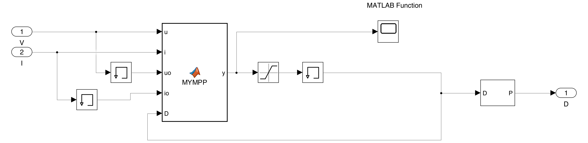
</p>

The scope trace demonstrates fast tracking during initialization:

<p align="center">
  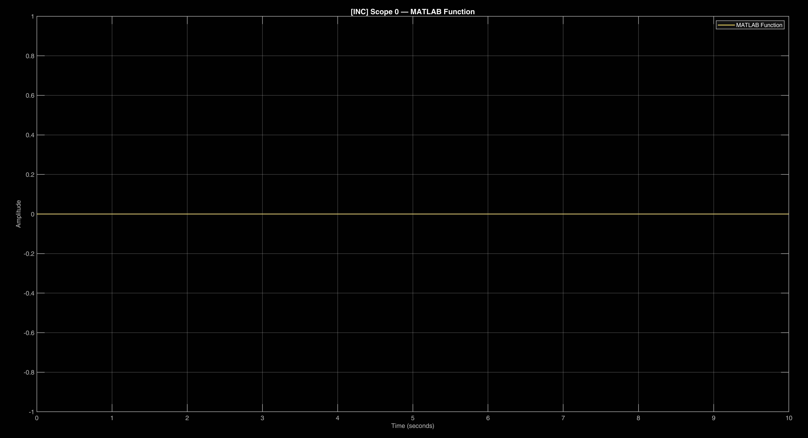
</p>

### Analytical Comparison: P&O vs. Incremental Conductance

| Evaluation Metric | Perturb & Observe (P&O) | Incremental Conductance (Inc. Cond.) | Engineering Justification |
| :--- | :--- | :--- | :--- |
| **Hardware Deployment** | **✅ Sole Active Algorithm** | ❌ Simulation Benchmark Only | P&O requires significantly less CPU execution overhead |
| **Computational Overhead**| Low (simple differences & sign test) | High (division operations dI/dV) | Division operations introduce numerical noise in fixed-point MCU |
| **Steady-State Behavior** | Minor limit-cycle oscillation | Mathematically stationary at MPP | Deadband threshold in C eliminates P&O hunting |
| **Dynamic Response** | Fast for moderate irradiance shifts | Fast during abrupt atmospheric shifts | P&O fulfills all practical microgrid dynamic standards |

---

## 4️⃣ Advanced Global Scanning MPPT for Partial Shading (`Central_Boost_MPPT_with_check.slx`)

Under **Partial Shading Conditions (PSC)**, bypassed module strings create multiple local maxima (LMPP) along the P-V characteristic curve. Classical gradient-based tracking methods (both P&O and Inc. Cond.) inevitably trap the converter at a suboptimal local peak.

To overcome this fundamental limitation, a supervisory **Global Scanning (Forced Sweep)** state machine was integrated with the central boost power stage.

### Central Boost Topology Overview

The high-power central boost converter interfaces the shaded PV array with the $600\text{ V}$ DC bus, commanded by the global supervisory controller:

<p align="center">
  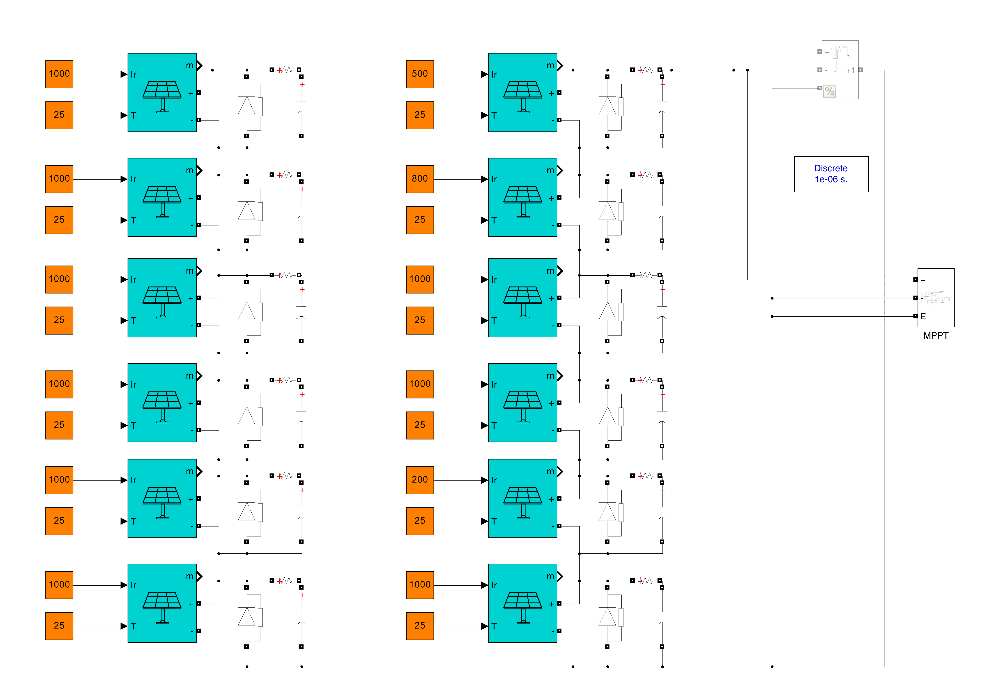
</p>

### Four-Stage Global Forced Sweep State Machine

The supervisory controller executes a deterministic sequential sweep when a power divergence is detected:

<p align="center">
  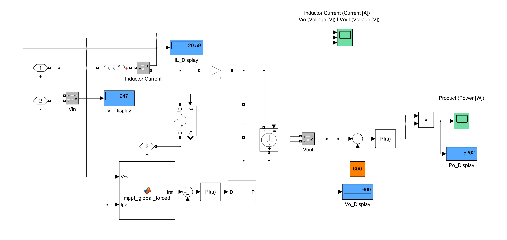
</p>

1. **State 1 — Periodic Trigger:** A supervisory timer periodically interrupts standard operation or triggers upon detecting a persistent power drop exceeding 15% ($\Delta P < -0.15 \cdot P_{\text{prev}}$).
2. **State 2 — Controlled Voltage Sweep:** The controller overrides the duty cycle, sweeping array terminal voltage from $300\text{ V}$ down to $240\text{ V}$ ($V_{\text{scan,min}}$).
3. **State 3 — Global Coordinate Memorization:** Instantaneous power is sampled across the sweep window, continuously updating registers with the coordinates of the true Global Maximum Power Point ($V_{\text{best}}, P_{\text{best}}$).
4. **State 4 — Target Lock & P&O Handover:** The controller modulates duty cycle directly toward $V_{\text{best}}$, restoring fine P&O tracking around the identified global summit.

### Global Peak Power Recovery Scope

The dynamic scope below shows the power recovering to the $\approx 5\text{ kW}$ level after the supervisory sweep (mean operating point $\approx 5.09\text{ kW}$ at $V_{\text{pv}} = 247.1\text{ V}$ and $I_L = 20.59\text{ A}$; switching-ripple envelope peak $5,202\text{ W}$):

<p align="center">
  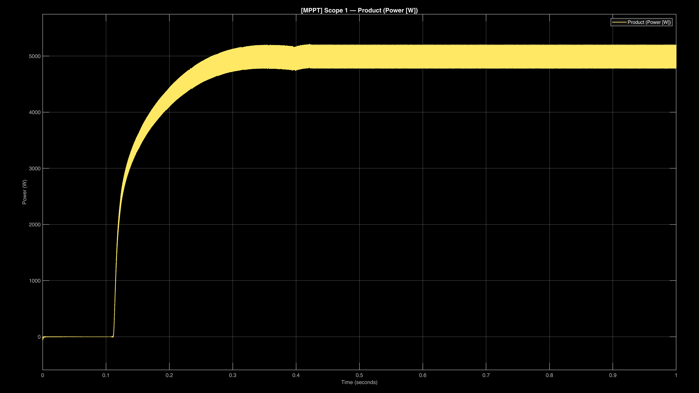
</p>

---

## 📂 Directory Structure & Simulation Execution Guide

```text
1_PV_Modeling_and_MPPT/
├── README.md                                          # PV modeling & MPPT technical documentation
├── pv_curves.slx                                      # Single-diode analytical curve extraction model
├── MPPT_PO1.slx                                       # Primary operational P&O tracking model
├── mppt_po.c                                          # ANSI C embedded microcontroller firmware source
├── Incremental_conductance.slx                        # Comparative simulation benchmark model
├── Central_Boost_MPPT_with_check.slx                  # Advanced Global Scanning MPPT under PSC
└── images/                                            # 300 DPI high-resolution architecture & scope assets
    ├── curves_model_300dpi.png
    ├── global_mppt_power_recovery_300dpi.png
    ├── global_mppt_state_machine_300dpi.png
    ├── global_mppt_system_300dpi.png
    ├── inc_cond_scope_300dpi.png
    ├── inc_cond_subsystem_300dpi.png
    ├── mppt_po_duty_tracking_300dpi.png
    ├── mppt_po_subsystem_300dpi.png
    ├── po_flowchart.png
    ├── pv_current_curve_300dpi.png
    └── pv_power_curve_300dpi.png
```

### Steps to Run the Models

1. **Analytical Curves:** Open and run `pv_curves.slx` in MATLAB/Simulink R2022b or later to visualize non-linear P-V and I-V curves.
2. **Primary P&O Tracking:** Open `MPPT_PO1.slx` to inspect the primary operational discrete P&O logic matching `mppt_po.c`.
3. **Comparative Inc. Cond. Study:** Open `Incremental_conductance.slx` to evaluate simulation-based conductance tracking against P&O.
4. **Partial Shading Global Sweep:** Execute `Central_Boost_MPPT_with_check.slx` to observe the four-state global voltage sweep recovering peak power ($5.2\text{ kW}$) under multi-peak conditions.
