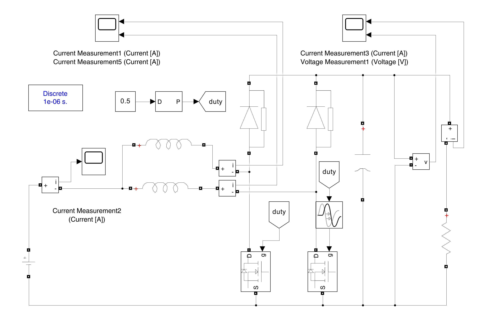
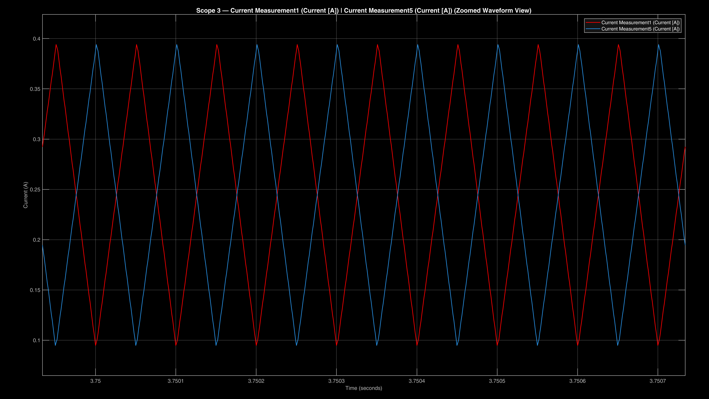
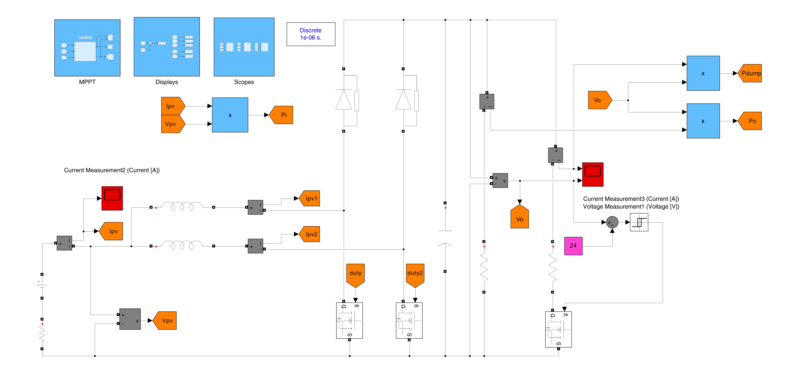
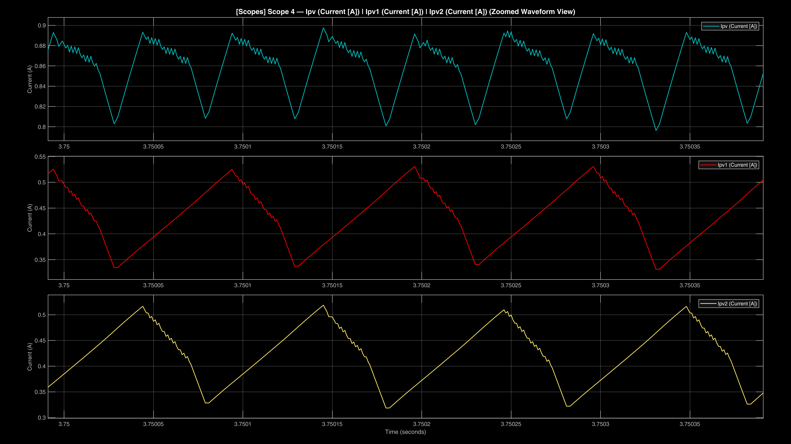
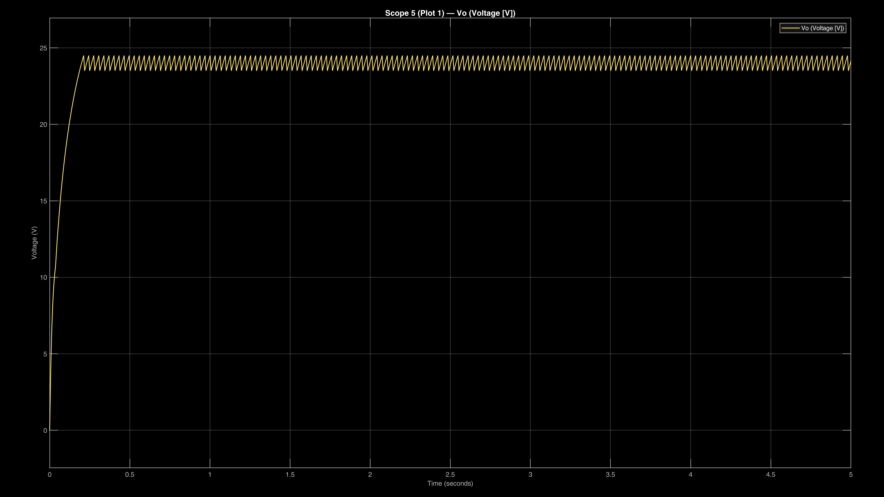
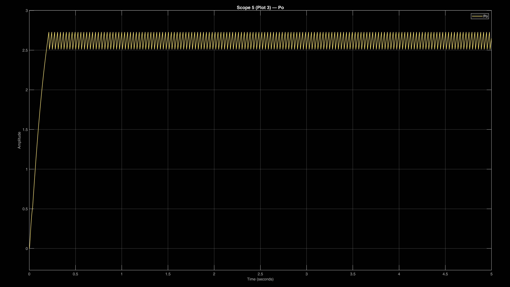

# ⚡ Two-Phase Interleaved Boost Converter & Full-Scale Sizing

> **Team Project:** Solar-Powered EV Charging Station with BESS (8-member team) — *documentation by Abd El-Rhman Muhammad Saad*  
> **Academic Institution:** Faculty of Engineering, Alexandria University (Class of 2026)  
> **Department:** Electrical Power and Machines Engineering  
> **Core Focus:** 8.5 kW Full-Scale Array Sizing, Two-Phase Ripple Cancellation Physics, High-Efficiency Boost Architecture & Active Current Sharing

---

This directory documents the design, analytical sizing, mathematical ripple modeling, and MATLAB/Simulink simulations for the **Two-Phase Interleaved Boost Converter** stage. Within our Solar-Powered EV Charging Station, this converter interfaces the photovoltaic array with the regulated 600 V DC-Link bus, providing high step-up conversion efficiency while minimizing input current ripple.

The repository captures our complete engineering design progression: from baseline open-loop prototyping to decoupled control tuning via Thevenin equivalents, culminating in a fully closed-loop multi-phase converter with active current sharing.

---

## 📌 Full-Scale PV Array Sizing & Design Specifications

To ensure the charging station delivers sufficient energy without overloading the battery storage, the system was sized based on daily solar insolation data for Alexandria, Egypt, as documented in Section 5.1 of the project thesis:

### Sizing Methodology

* **Target Daily Energy Delivery:** $E_{\text{daily}} = 42.5\text{ kWh/day}$
* **Average Peak Sun Hours (Alexandria, Egypt):** $T_{\text{peak}} \approx 5\text{ hours}$
* **Required PV Array Nominal Power:**

$$P_{\text{PV}} = \frac{E_{\text{daily}}}{T_{\text{peak}}} = \frac{42.5\text{ kWh}}{5\text{ h}} = 8500\text{ W} \quad (\mathbf{8.5\text{ kW}})$$

* **Module Selection:** High-efficiency monocrystalline modules ($P_{\text{module}} = 710\text{ W}$, $V_m = 40.9\text{ V}$, $I_m = 17.36\text{ A}$).
* **Total Module Count:**

$$N_{\text{modules}} = \frac{8500\text{ W}}{710\text{ W}} \approx 12\text{ Modules}$$

* **Array Configuration:** 2 parallel strings of 6 series modules ($N_s = 6, N_p = 2$).
* **Nominal Array Voltage:** $V_{\text{in}} = 6 \times 40.9\text{ V} \approx 245.4\text{ V}$

### Converter Operating Specifications

| Parameter | Symbol | Value | Design Context |
| :--- | :---: | :---: | :--- |
| **Nominal Input Power** | $P_{\text{in}}$ | $8.5\text{ kW}$ | Total array peak generation |
| **Nominal Array Voltage** | $V_{\text{in}}$ | $\approx 245.4\text{ V}$ | 6 series modules per string ($N_s = 6$) |
| **Regulated Output Voltage** | $V_{\text{DC}}$ | $600.0\text{ V}$ | Central microgrid DC-Link potential |
| **Nominal Voltage Gain** | $M_v$ | $2.445$ | Step-up boost ratio ($V_{\text{DC}} / V_{\text{in}}$) |
| **Nominal Duty Cycle** | $D$ | $\approx 0.591$ | Operating duty ratio ($1 - V_{\text{in}} / V_{\text{DC}}$) |
| **Switching Frequency** | $f_{\text{sw}}$ | $10\text{ kHz}$ | Per-phase switching rate |
| **Effective Ripple Frequency** | $f_{\text{eff}}$ | $20\text{ kHz}$ | Interleaved ripple cancellation ($2 \cdot f_{\text{sw}}$) |
| **Phase Displacement** | $\theta$ | $180^\circ$ | Symmetrical PWM carrier displacement |

---

## 🔬 Ripple Cancellation Physics & Mathematical Modeling

The primary engineering justification for selecting an interleaved topology over a conventional single-switch boost converter is **input current ripple cancellation** and thermal stress distribution across parallel semiconductors.

### Mathematical Derivation

In a conventional single-phase boost converter, the inductor current ripple is:

$$\Delta I_{L,\text{single}} = \frac{V_{\text{in}} \cdot D}{L \cdot f_{\text{sw}}}$$

In a **two-phase interleaved topology**, two identical inductors ($L_1 = L_2 = L$) operate in parallel with gating pulses shifted by a half-period ($T_{\text{sw}}/2 = 180^\circ$). The total input current drawn from the PV array is the instantaneous sum of both branch currents:

$$i_{\text{in}}(t) = i_{L1}(t) + i_{L2}(t)$$

Applying superposition over switching intervals yields the net input current ripple ($\Delta I_{\text{in}}$):

$$\Delta I_{\text{in}} = \frac{V_{\text{DC}}}{L \cdot f_{\text{sw}}} \cdot D (1 - 2D) \quad \text{for } D \le 0.5$$

$$\Delta I_{\text{in}} = \frac{V_{\text{DC}}}{L \cdot f_{\text{sw}}} \cdot (2D - 1)(1 - D) \quad \text{for } D > 0.5$$

### Key Engineering Insights

1. **Zero Theoretical Ripple at $D = 0.5$:** At a 50% duty cycle, the rising slope of $i_{L1}$ cancels (ideal case) the falling slope of $i_{L2}$, driving net input ripple to zero ($\Delta I_{\text{in}} = 0$).
2. **$\approx 66.7\%$ Ripple Reduction at Nominal Duty ($D \approx 0.60$):**

$$\frac{\Delta I_{\text{in}}}{\Delta I_L} = \frac{2D - 1}{D} = \frac{2(0.591) - 1}{0.591} \approx 0.308$$

The input ripple drawn from the PV array is reduced by nearly **70%** compared to a single-phase converter.
3. **Capacitor Longevity & Thermal Relief:** Lower high-frequency ripple drastically suppresses resistive heating ($I_{\text{rms}}^2 \cdot \text{ESR}$) in input filter capacitors, directly extending component operating life.

---

## 🏛️ Architectural Comparison: Central vs. String Topologies

Our research explored two primary distribution strategies for deploying the interleaved converter stage across the charging infrastructure:

* **Centralized Interleaved Topology:** Connects all 12 modules (2 parallel strings of 6 series modules) to a single high-capacity multi-phase converter. Minimizes BOM component count, reduces control hardware complexity, and optimizes peak conversion efficiency under uniform sunlight conditions.
* **String Interleaved Topology:** Employs modular converters dedicated to individual solar strings. Provides superior energy yield under non-uniform partial shading and independent MPPT granularity, but requires additional sensing hardware and gate drivers.

---

## 🛠️ Progressive 5-Stage Converter Evolution

The repository documents the complete chronological progression of the converter stage across 5 specialized Simulink models:

| Model File | Topology & Configuration | Control Scheme | Primary Purpose |
| :--- | :--- | :--- | :--- |
| **`Boost_Source_Open_Loop.slx`** | Single-Phase Boost | Open-Loop ($D = 0.5$) | Baseline verification of passive component sizing and boost ratio |
| **`Interleaved_Boost_Source_Open_Loop.slx`** | 2-Phase Interleaved Boost | Open-Loop ($180^\circ$ shift) | Dynamic validation of current sharing and input ripple cancellation |
| **`Boost_Thevenin_Equivalent.slx`** | Single-Phase with Thevenin Source | Open-Loop | Decoupling converter dynamics from non-linear PV curve for control analysis |
| **`Interleaved_Boost_Thevenin_Equivalent.slx`** | 2-Phase Interleaved Thevenin | Open-Loop | Multi-phase plant model formulation for linear control design |
| **`Interleaved_Boost_Thevenin_Full_Control_ForDesign.slx`** | Full Closed-Loop Interleaved | Dual-Loop PI (Voltage + Dual Current) | Final control architecture: 600 V bus regulation and active 50% / 50% current sharing |

---

## 📐 Architecture Schematics & Waveform Verification

### 1. Interleaved Power Stage Open-Loop Validation
The 2-phase power stage integrates parallel inductors and complementary IGBT switches displaced by $180^\circ$:

<p align="center">
  
</p>

### 2. Physical Ripple Cancellation Waveform
The zoomed scope below captures the $180^\circ$ out-of-phase inductor currents ($i_{L1}$ and $i_{L2}$) and demonstrates how their sum produces a smooth input current with negligible ripple:

<p align="center">
  
</p>

### 3. Full Closed-Loop Architecture
The final design implements an outer voltage regulation loop cascaded into dual inner current loops to maintain balanced current sharing ($\approx 50/50$) and bus stability:

<p align="center">
  
</p>

### 4. Closed-Loop Inductor Current Sharing
Both phases share the load current symmetrically ($50\% / 50\%$) under closed-loop control, preventing thermal imbalance across individual switches:

<p align="center">
  
</p>

### 5. Regulated 600 V DC Bus Output
The closed-loop PI voltage controller firmly holds the DC-Link voltage at **$600.0\text{ V}$** with tight steady-state regulation:

<p align="center">
  
</p>

### 6. Full-Power Delivery Verification
The converter delivers full rated power ($8.5\text{ kW}$) to the DC bus under nominal conditions:

<p align="center">
  
</p>

---

## 📂 Directory Structure & Simulation Execution Guide

```text
2_Interleaved_Boost_Converter/
├── README.md                                                  # Comprehensive technical documentation
├── Boost_Source_Open_Loop.slx                                 # Baseline single-phase open-loop model
├── Boost_Thevenin_Equivalent.slx                              # Single-phase Thevenin plant model
├── Interleaved_Boost_Source_Open_Loop.slx                     # 2-phase interleaved open-loop model
├── Interleaved_Boost_Thevenin_Equivalent.slx                  # 2-phase Thevenin plant model
├── Interleaved_Boost_Thevenin_Full_Control_ForDesign.slx      # Full closed-loop multi-phase converter model
└── images/                                                    # 300 DPI high-resolution architecture & scope assets
    ├── current_sharing_closed_loop_300dpi.png
    ├── dc_bus_voltage_600v_300dpi.png
    ├── interleaved_full_control_model_300dpi.png
    ├── interleaved_open_loop_model_300dpi.png
    ├── output_power_delivery_300dpi.png
    └── ripple_cancellation_currents_300dpi.png
```

### Steps to Run the Simulation Models

1. **Open MATLAB:** Set the working directory to `2_Interleaved_Boost_Converter/`.
2. **Open-Loop Ripple Verification:** Open `Interleaved_Boost_Source_Open_Loop.slx` and run the simulation to inspect the $180^\circ$ inductor current ripple cancellation.
3. **Decoupled Control Study:** Open `Interleaved_Boost_Thevenin_Equivalent.slx` to inspect plant transfer functions and frequency-response margins.
4. **Closed-Loop System Simulation:** Run `Interleaved_Boost_Thevenin_Full_Control_ForDesign.slx` to observe closed-loop current sharing and $600\text{ V}$ bus regulation.
5. **Solver Configuration:** The models use discrete `powergui` with a fixed sample time $T_s = 1.0\ \mu\text{s}$ for fast and numerically stable simulation.
