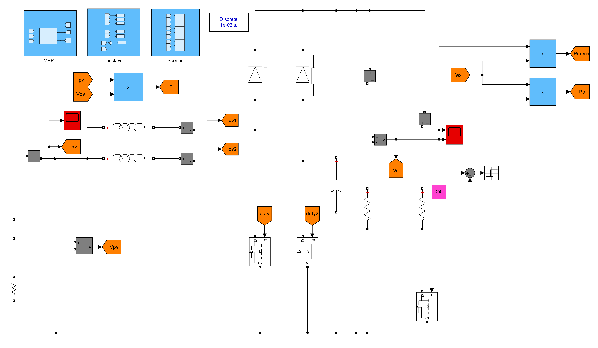
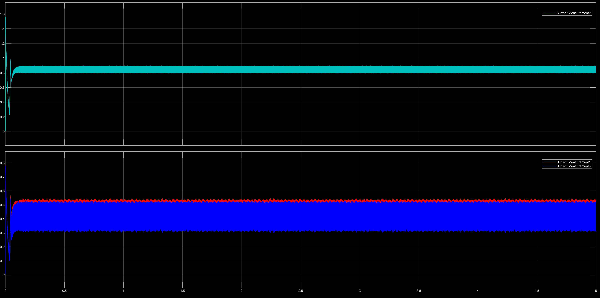
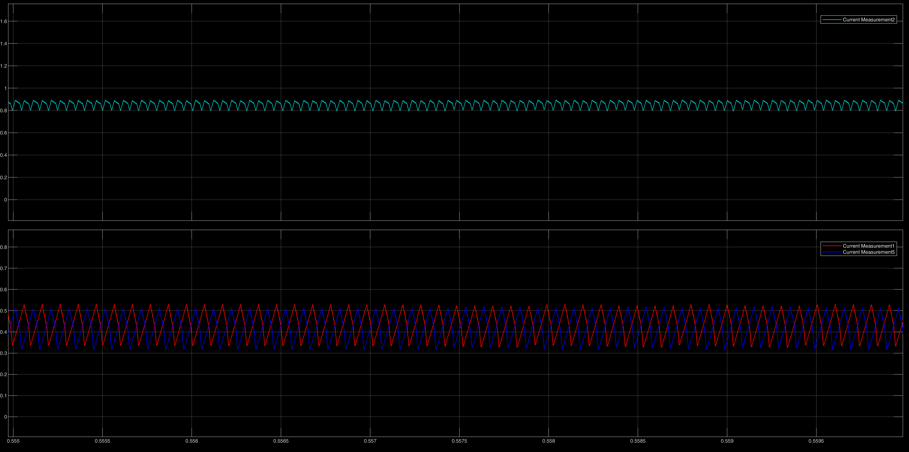
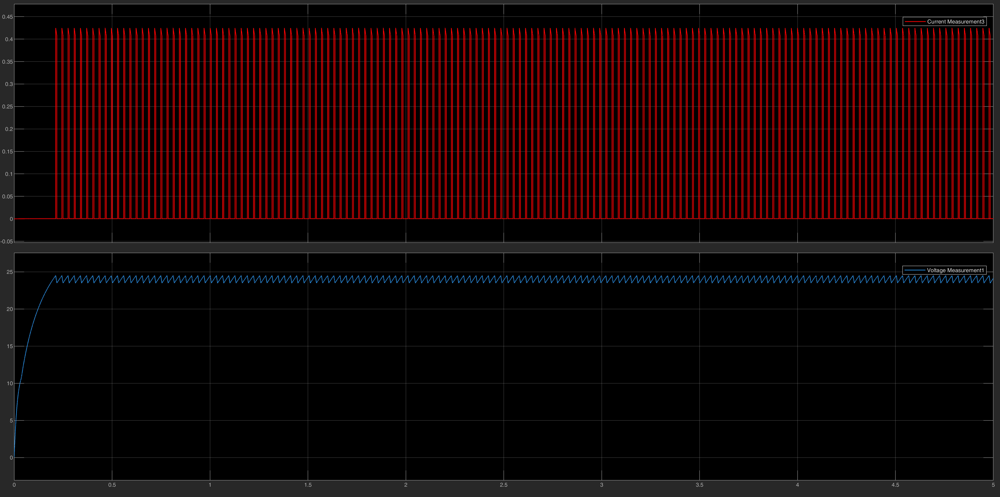
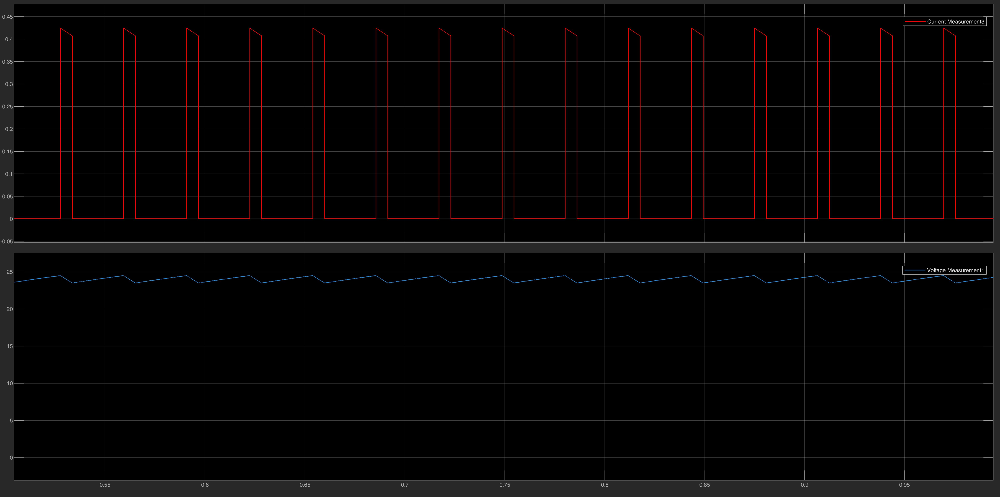

# ⚡ Two-Phase Interleaved Boost Converter & Full-Scale Sizing

This directory documents the design, analytical sizing, mathematical ripple modeling, and MATLAB/Simulink simulations for the **Two-Phase Interleaved Boost Converter** stage. Within our Solar-Powered EV Charging Station, this converter interfaces the photovoltaic array with the regulated 600V DC-Link bus, providing high step-up efficiency while minimizing input current ripple.

The repository captures our complete engineering design progression: from baseline open-loop prototyping to decoupled control tuning via Thevenin equivalents, culminating in a fully closed-loop multi-phase converter.

---

## 📐 Full-Scale PV Array Sizing & Design Specifications

To ensure the charging station delivers sufficient energy without overloading the battery storage, the system was sized based on daily solar insolation data and load requirements as documented in Section 5.1 of the project thesis:

### Sizing Methodology:

* **Target Daily Energy Delivery:** $E_{daily} = 42.5\text{ kWh/day}$
* **Average Peak Sun Hours (Alexandria, Egypt):** $T_{peak} \approx 5\text{ hours}$
* **Required PV Array Nominal Power:**

$$
P_{PV} = \frac{E_{daily}}{T_{peak}} = \frac{42.5\text{ kWh}}{5\text{ h}} = 8500\text{ W} \quad (\mathbf{8.5\ kW})
$$

* **Module Selection:** High-efficiency monocrystalline modules ($P_{module} = 710\text{ W}$, $V_m = 40.9\text{ V}$, $I_m = 17.36\text{ A}$).
* **Total Module Count:**

$$
N_{modules} = \frac{8500\text{ W}}{710\text{ W}} \approx 12\text{ Modules}
$$

### Overall Converter Parameter Specifications:

| Parameter | Symbol | Value | Design Context |
| :--- | :---: | :---: | :--- |
| **Nominal Input Power** | $P_{in}$ | $8.5\text{ kW}$ | Total array peak generation |
| **Nominal Array Voltage**| $V_{in}$ | $\approx 245.4\text{ V}$ | 6 series modules per string ($N_s = 6$) |
| **Regulated Output Voltage**| $V_{DC}$ | $600.0\text{ V}$ | Standard microgrid DC-Link potential |
| **Nominal Voltage Gain** | $M_v$ | $2.44$ | Boost ratio ($V_o / V_{in}$) |
| **Switching Frequency** | $f_{sw}$ | $10\text{ kHz}$ | Per-phase switching rate |
| **Effective Ripple Frequency**| $f_{eff}$ | $20\text{ kHz}$ | Interleaved input cancellation rate ($2 \cdot f_{sw}$) |
| **Phase Displacement** | $\theta$ | $180^\circ$ | Interleaved PWM gate displacement |

---

## 🧠 Ripple Cancellation Physics & Mathematical Modeling

The central engineering justification for selecting an interleaved topology over a single-switch boost converter is **input current ripple cancellation** and reduced thermal stress on passive components.

### Mathematical Derivation:

In a conventional single-phase boost converter, the inductor current ripple is:

$$
\Delta I_{L\_single} = \frac{V_{in} \cdot D}{L \cdot f_{sw}}
$$

In a **two-phase interleaved topology**, the two identical inductors ($L_1 = L_2 = L$) operate in parallel with gating pulses shifted by a half-period ($T_{sw}/2 = 180^\circ$). The total input current drawn from the PV array is the instantaneous sum of both branch currents:

$$
i_{in}(t) = i_{L1}(t) + i_{L2}(t)
$$

Applying superposition over switching intervals yields the net input current ripple ($\Delta I_{in}$):

$$
\Delta I_{in} = \frac{V_o}{L \cdot f_{sw}} \cdot D (1 - 2D) \quad \text{for } D \le 0.5
$$

$$
\Delta I_{in} = \frac{V_o}{L \cdot f_{sw}} \cdot (2D - 1)(1 - D) \quad \text{for } D > 0.5
$$

### Key Engineering Deductions:

1. **Zero Theoretical Ripple at $D = 0.5$:** At a 50% duty cycle, the rising slope of $i_{L1}$ perfectly cancels the falling slope of $i_{L2}$, driving net input ripple to zero ($\Delta I_{in} = 0$).
2. **$>50\%$ Ripple Reduction:** Across all practical operational duty cycles ($0.2 < D < 0.8$), the input current ripple is attenuated by over 50% compared to a single-phase converter of equivalent power rating.
3. **Capacitor Longevity:** Reducing input current ripple dramatically suppresses high-frequency heating across the input filter capacitors, directly prolonging PV module and capacitor operating life.

---

## 🏛️ Architectural Comparison: Central vs. String Topologies

Our research explored two primary distribution strategies for deploying the interleaved converter stage:

* **Centralized Interleaved Topology:** Connects all 12 modules (2 parallel strings of 6 modules) to a single high-capacity multi-phase converter. Minimizes BOM component count, reduces control complexity, and optimizes peak conversion efficiency under uniform sunlight.
* **String Interleaved Topology:** Employs modular converters dedicated to individual strings. Provides superior energy yield under non-uniform shading and independent MPPT granularity, but requires additional sensing hardware.

---

## 📂 Engineering Progression & File Manifest

Our design process is captured across five sequential models:

### Phase 1: Open-Loop Baseline Validation

* **`Boost_Source_Open_Loop.slx`**: Validates basic step-up ratio and steady-state operating points on a single-phase inductor branch.
* **`Interleaved_Boost_Source_Open_Loop.slx`**: Implements parallel branches with $180^\circ$ phase-shifted gate pulses to visually confirm natural ripple cancellation prior to closing the feedback loop.

### Phase 2: Decoupled Control Tuning via Thevenin Equivalent

* **`Boost_Thevenin_Equivalent.slx`**: Replaces the non-linear PV array with a parameterized Thevenin circuit (Controlled Current Source + DC Voltage Source), allowing analytical tuning of voltage/current PI parameters without solar non-linearities.
* **`Interleaved_Boost_Thevenin_Equivalent.slx`**: Applies the tuned multi-loop architecture to the interleaved topology.

### Phase 3: Final Integrated System

* **`Interleaved_Boost_Thevenin_Full_Control_ForDesign.slx`**: The production-level model featuring cascaded inner current and outer voltage PI loops, anti-windup clamping, and real-time PWM generation.

---

## 🏗️ System Architecture & Visual Verification

**Integrated Interleaved Model (`Interleaved_Boost_Thevenin_Full_Control_ForDesign.slx`):**

---

## 📊 Experimental Simulation Results

### 1. Verification of Ripple Cancellation (The Interleaving Advantage)

The scope captures the individual inductor currents ($I_{L1}$ in red, $I_{L2}$ in blue) exhibiting expected ripple. Their instantaneous summation ($I_{total}$ in cyan) demonstrates remarkable ripple attenuation, confirming our mathematical derivations.

| Input Current Ripple Summation | Zoomed-in Waveform Details |
| :---: | :---: |
|  |  |

### 2. Tight Output DC-Link Regulation (600V Target)

The closed-loop multi-loop control maintains rock-solid regulation of the output voltage and current under dynamic load steps.

| Regulated Output Waveforms | Zoomed Steady-State Output |
| :---: | :---: |
|  |  |

---

## 🔧 How to Run

1. Open MATLAB and navigate to `2_Interleaved_Boost_Converter/`.
2. To inspect the progressive design evolution, run any model from Phase 1 through Phase 3.
3. Open the scope blocks to evaluate current ripple cancellation and output voltage settling times.

