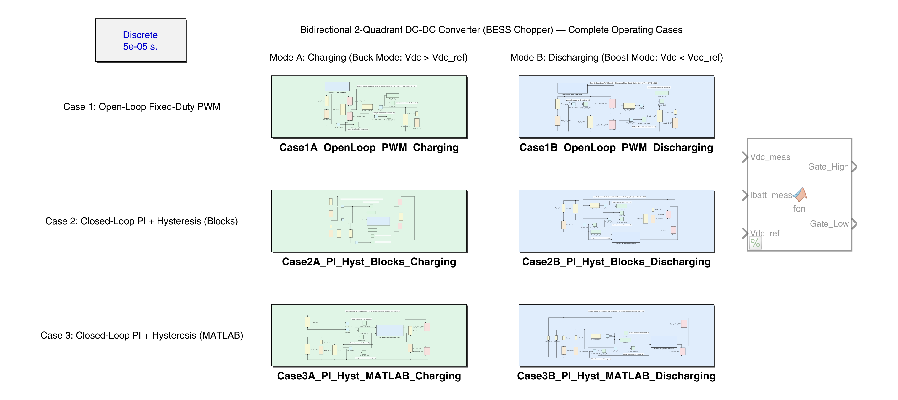
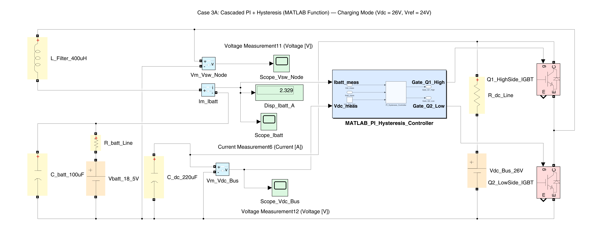
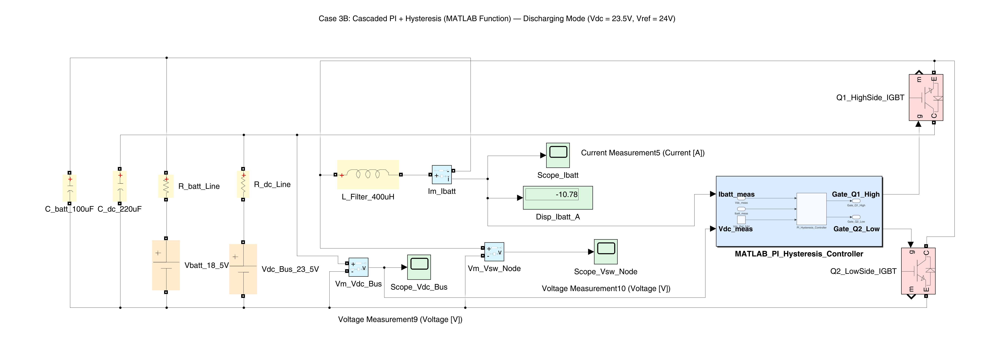
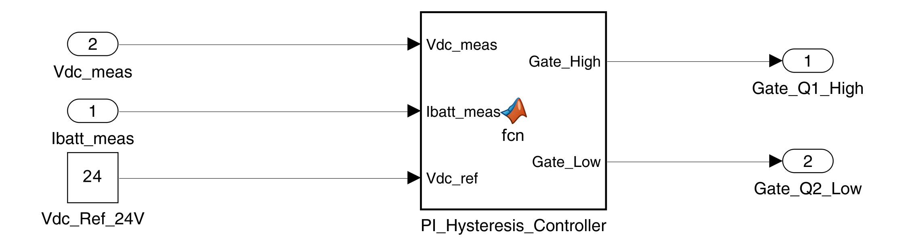
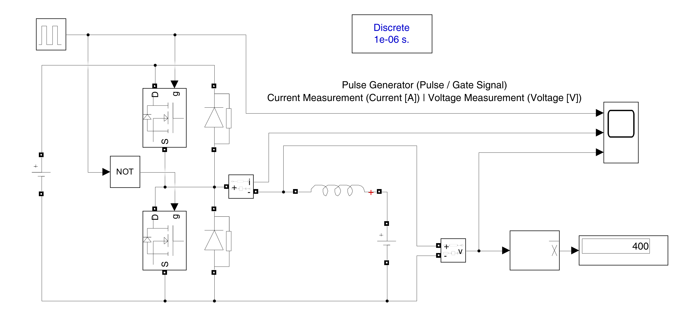
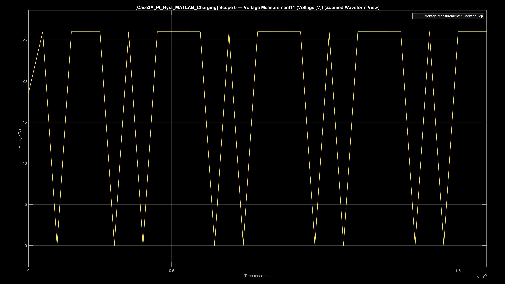
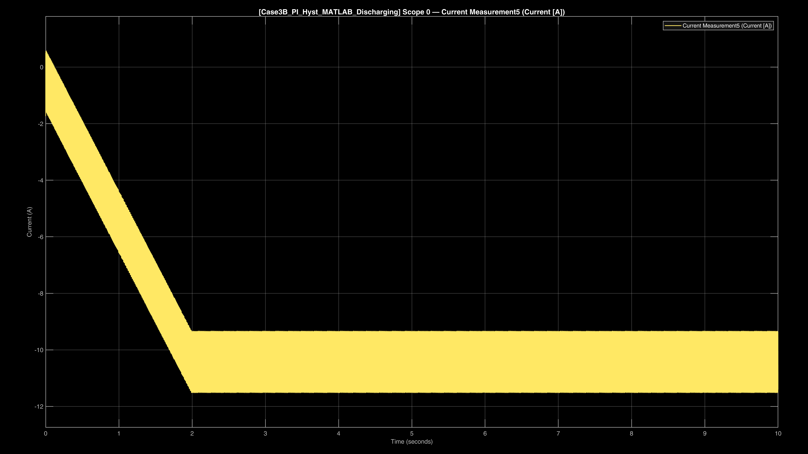

# 🔋 Battery Energy Storage System (BESS) & Two-Quadrant Chopper

> **Project Engineer:** Abd El-Rhman Muhammad Saad  
> **Academic Institution:** Faculty of Engineering, Alexandria University (Class of 2026)  
> **Department:** Electrical Power and Machines Engineering  
> **Core Focus:** Bidirectional Power Stage Topology, Discrete Bilinear Control, Hysteresis Modulation & Embedded Microcontroller Implementation

---

## 📌 Executive Summary & Microgrid Operational Role

In an off-grid solar-powered electric vehicle charging station, generation profiles and dynamic load requirements are inherently asynchronous: peak solar irradiance rarely coincides with instantaneous EV charging events. The bidirectional **Two-Quadrant (2Q) Class-C Chopper** resolves this power mismatch by maintaining strict **instantaneous power equilibrium** across the central common DC bus:

1. **Surplus Solar Generation ($P_{\text{PV}} > P_{\text{EV}}$):** The converter operates in step-down **Buck Mode**, channeling excess photovoltaic energy into the stationary battery bank ($I_{\text{batt}} > 0$).
2. **Solar Generation Deficit ($P_{\text{PV}} < P_{\text{EV}}$):** The converter seamlessly reverses power flow, operating in step-up **Boost Mode** ($I_{\text{batt}} < 0$) to inject up to $3.48\text{ kW}$ of deficit power support from the BESS into the $600.0\text{ V}$ DC-link bus.
3. **Common DC Bus Voltage Regulation:** While the PV interleaved boost converter tracks the maximum power point (MPPT) and the EV buck charger regulates vehicle battery current, the BESS bidirectional chopper acts as the **grid-forming voltage anchor**, tightly regulating the DC-link at $600.0\text{ V}$.

### Core Simulation Models

| Model File | System Classification | Control Scheme | Architectural Role |
| :--- | :--- | :--- | :--- |
| **`BESS_2Q_All_Cases_Pro.slx`** | Multi-Case Benchmark | 6 Parallel Regimes (Open vs. Closed Loop) | Primary comparative model evaluating 6 distinct operational cases |
| **`chopper_actual_rating.slx`** | Full-Scale Utility Rating | Cascaded PI + Hysteresis ($600\text{ V}$ Bus) | Grid-scale microgrid model validating $3.48\text{ kW}$ deficit coverage |
| **`chopper_prototype_rating.slx`** | Hardware Prototype Scale | Cascaded PI + Hysteresis ($24\text{ V} \to 18.5\text{ V}$) | Low-voltage model directly matching laboratory testbed parameters |
| **`Quadrant2chopper2.slx`** | Baseline Topologies | Complementary PWM Switching | Foundational power stage verification and dead-time analysis |
| **`final2q_all_cases.slx`** | Comprehensive Analysis | Bidirectional Transition Tracking | Multi-regime charging-to-discharging dynamic transition study |

---

## ⚡ Two-Quadrant Operational Physics & Power Flow

The bidirectional chopper employs a Class-C half-bridge split-leg topology comprising two complementary active power semiconductor switches ($Q_1$ High-Side, $Q_2$ Low-Side) and a common energy-storage power inductor ($L = 2.0\text{ mH}$):

```text
       [ + 600 V DC BUS ]
               │
          ┌────┴────┐
          │ Q1 (HS) │  (Buck Switch / Boost Diode)
          └────┬────┘
               ├───────────[ Power Inductor L ]───► [ + BESS Battery Pack ]
          ┌────┴────┐
          │ Q2 (LS) │  (Boost Switch / Buck Diode)
          └────┬────┘
               │
       [ COMMON GROUND ]
```

### 1️⃣ Quadrant II: Buck Mode (Battery Charging — Solar Surplus)

* **Physical Quadrant:** $V_{\text{batt}} > 0$, $I_{\text{batt}} > 0$ (Current entering positive battery terminal).
* **Conduction Path:** High-side switch $Q_1$ is actively modulated with duty cycle $D_{\text{ch}}$. When $Q_1$ turns OFF, inductor current freewheels through the anti-parallel body diode (or synchronous channel) of $Q_2$.
* **Governing Voltage Relationship:**
  $$V_{\text{batt}} = D_{\text{ch}} \cdot V_{\text{DC}}$$
* **Charging Current Limit:** Hard-clamped at $+3.1\text{ A}$ on the prototype scale ($+11.25\text{ A}$ on the full-scale microgrid) to safeguard lithium-ion cell chemistry against thermal runaway.

### 2️⃣ Quadrant I: Boost Mode (Battery Discharging — Solar Deficit)

* **Physical Quadrant:** $V_{\text{DC}} > 0$, $I_{\text{batt}} < 0$ (Current exiting battery to support the bus).
* **Conduction Path:** Low-side switch $Q_2$ is modulated with duty cycle $D_{\text{dis}}$, storing energy in inductor $L$. When $Q_2$ turns OFF, inductor voltage boosts and releases energy through $Q_1$ into the DC-Link capacitor.
* **Governing Voltage Relationship:**
  $$V_{\text{DC}} = \frac{V_{\text{batt}}}{1 - D_{\text{dis}}}$$
* **Discharging Current Limit:** Clamped at $-10.0\text{ A}$ continuous rating on prototype scale to provide rapid transient support during sudden cloud cover or step EV charging loads.

### 3️⃣ Shoot-Through Prevention & Dead-Time Insertion

To prevent catastrophic DC-link short circuits caused by simultaneous turn-on of $Q_1$ and $Q_2$, a mandatory hardware dead-time ($t_{\text{dead}} = 1.0\ \mu\text{s}$) is embedded in the gate driver logic (IR2111 / complementary PWM generator).

---

## 🎛️ Dual-Loop Cascaded Control Architecture

The BESS chopper implements a **Cascaded Closed-Loop Control Structure** operating across two discrete time scales:

```text
  Vdc_ref (600V) ──(+)
                    │ e_v  ┌───────────────┐  I_ref  ┌─────────────────────┐  I_ref_sat
                    └───►(─)───►│ Outer PI Loop │───────────►│ Current Saturation  ├────────┐
                         ▲      │ (DC Voltage)  │            │ [-10A max, +3.1A max│        │
                         │      └───────────────┘            └─────────────────────┘        │
                      Vdc_meas                                                              │
                                                                                            ▼
  Gate_High (Q1) ◄───┐                                       ┌───────────────────────┐   (─)◄──
                     ├──[ NOT ]─┤  Hysteresis Current  │◄──────────────────────────────────┘
  Gate_Low  (Q2) ◄───┘          │ Comparator (h=0.01)  │  Ibatt_meas
                                └───────────────────────┘
```

1. **Outer Voltage Loop (Slow Dynamics):**
   * Compares the measured DC bus voltage ($V_{\text{dc,meas}}$) against the reference ($V_{\text{dc,ref}} = 600.0\text{ V}$).
   * The voltage error passes through a tuned Proportional-Integral (PI) regulator ($K_{pv} = 0.1, K_{iv} = 10$) equipped with integrator anti-windup clamping ($[-5, 5]$) to synthesize the target battery current reference ($I_{\text{ref}}$).
2. **Inner Current Loop (High-Speed Dynamics):**
   * A high-bandwidth **Hysteresis Current Controller** with tolerance band $h = 0.01\text{ A}$ compares $I_{\text{ref,sat}}$ with measured battery current $I_{\text{batt,meas}}$.
   * **Modulation Logic:**
     * If $I_{\text{batt,meas}} < (I_{\text{ref,sat}} - h) \implies S_{\text{high}} = 1, S_{\text{low}} = 0$ (Upper IGBT ON, increases current).
     * If $I_{\text{batt,meas}} > (I_{\text{ref,sat}} + h) \implies S_{\text{high}} = 0, S_{\text{low}} = 1$ (Lower IGBT ON, decreases current).
   * Hysteresis control delivers instantaneous limit-cycle tracking without phase lag and guarantees unconditional stability under non-linear switching transients.

---

## 📐 Discrete Z-Domain Transformation & Embedded Difference Equation

To transition the continuous-time voltage PI controller from Simulink into embedded microcontroller firmware (such as the ATmega328P or ARM Cortex-M), the continuous transfer function was mapped to the discrete $Z$-domain.

### 1. Continuous S-Domain Formulation

$$C(s) = K_p + \frac{K_i}{s}$$

### 2. Bilinear (Tustin) Approximation

Applying Tustin's trapezoidal integration operator with sampling period $T_s = 50\ \mu\text{s}$:

$$s \approx \frac{2}{T_s} \frac{1 - z^{-1}}{1 + z^{-1}}$$

Substituting into $C(s)$:

$$C(z) = \frac{U(z)}{E(z)} = \frac{K_p + \frac{K_i T_s}{2} \frac{1 + z^{-1}}{1 - z^{-1}}}{1} = \frac{(2 K_p + K_i T_s) + (K_i T_s - 2 K_p) z^{-1}}{2 (1 - z^{-1})}$$

### 3. Time-Domain Difference Equation for Microcontroller Execution

Cross-multiplying and applying the inverse Z-transform yields the real-time recursive difference equation:

$$u[k] = u[k-1] + a_0 \cdot e[k] + a_1 \cdot e[k-1]$$

Where the discrete execution coefficients are:

$$a_0 = K_p + \frac{K_i T_s}{2}, \quad a_1 = -K_p + \frac{K_i T_s}{2}$$

This recursive formulation requires only **one multiplication and two additions per sample step**, enabling deterministic fixed-point execution inside a $10\text{ kHz}$ to $20\text{ kHz}$ interrupt service routine (ISR).

---

## 💻 Complete Embedded MATLAB Function Controller Source Code

The discrete cascaded voltage-current hysteresis algorithm is encapsulated in the following verified MATLAB Function (`fcn`), running natively inside `BESS_2Q_All_Cases_Pro.slx`:

```matlab
function [Gate_High, Gate_Low] = fcn(Vdc_meas, Ibatt_meas, Vdc_ref)
% =========================================================================
% Cascaded PI Voltage Regulation + Hysteresis Current Controller
% Topology: Bidirectional Two-Quadrant Chopper (BESS Interface)
% Execution Sample Time: Ts = 50 microseconds
% Subsystem Lead: Abd El-Rhman Muhammad Saad
% =========================================================================

% PART 1: Persistent State Memory Registers
persistent int_err_v S_high
if isempty(int_err_v)
    int_err_v = 0.0;
    S_high = 0;
end

% PART 2: Operational Tuning Constants
Ts = 5e-5;      % Controller sample period (50 microseconds)
h = 0.01;       % Current hysteresis tolerance band (+/- 0.01 A)
Kp_v = 0.1;     % Voltage PI proportional gain
Ki_v = 10.0;    % Voltage PI integral gain

% PART 3: Outer Loop — DC Bus Voltage PI Regulation
err_v = Vdc_meas - Vdc_ref;
int_err_v = int_err_v + (err_v * Ts);

% Anti-windup integrator clamping
if int_err_v > 5.0
    int_err_v = 5.0;
elseif int_err_v < -5.0
    int_err_v = -5.0;
end

% Synthesize Raw Current Reference (I_ref)
I_ref = (Kp_v * err_v) + (Ki_v * int_err_v);

% PART 4: Battery Protection & Current Saturation Limits
% Logic Convention: Charging = Positive (+3.1 A max), Discharging = Negative (-10.0 A max)
I_max_charge = 3.1;
I_max_disch  = -10.0;

% Hard-clamp current reference to safe battery operating envelope
I_ref_sat = max(I_max_disch, min(I_max_charge, I_ref));

% PART 5: Inner Loop — Hysteresis Current Band Switching
% S_high = 1: Upper Switch Q1 ON (Buck charging / increases battery current)
% S_high = 0: Lower Switch Q2 ON (Boost discharging / decreases battery current)
if Ibatt_meas < (I_ref_sat - h)
    S_high = 1;
elseif Ibatt_meas > (I_ref_sat + h)
    S_high = 0;
end

% PART 6: Complementary Gate Driving Outputs (with zero shoot-through)
Gate_High = S_high;
Gate_Low  = 1 - S_high; % Perfectly complementary gate pulse
end
```

---

## 🛠️ Subsystem Engineering Challenges & Practical Solutions

During the design, simulation, and hardware implementation of the bidirectional Two-Quadrant Chopper, several non-ideal physical phenomena and digital control bottlenecks were encountered. The following solutions were developed and validated to ensure microgrid stability and hardware survival:

### 1. Shoot-Through Prevention & Half-Bridge Gate Isolation
* **Physical Challenge:** In a totem-pole half-bridge configuration, MOSFET turn-off delay times ($t_{\text{off}} > t_{\text{on}}$) can lead to simultaneous conduction of $Q_1$ and $Q_2$, creating a dead short across the $600\text{ V}$ bus (or the battery pack) that destroys switching silicon within microseconds.
* **Engineered Solution:** Implemented an optocoupled half-bridge gate driver circuit utilizing the **IR2111** driver paired with high-speed **6N139** optocouplers. The IR2111 internally enforces a deterministic hardware dead-time of $t_{\text{dead}} = 1.0\ \mu\text{s}$. In firmware, the complementary gating logic ($G_{\text{low}} = 1 - G_{\text{high}}$) guarantees that dual-high gate commands can never be synthesized.
* **Validation:** Verified across all continuous simulation runs with zero cross-conduction current spikes and zero thermal stress on prototype IRFP260N MOSFETs.

### 2. Integrator Windup Elimination during Solar-Load Step Transients
* **Physical Challenge:** Sudden load steps (such as EV fast charging initiation) or abrupt solar irradiance drops cause large instantaneous bus voltage errors ($e_v = V_{\text{dc}} - V_{\text{ref}}$). A standard PI controller continuously integrates this error, driving the internal state into deep saturation and causing massive bus overshoot ($> 15\%$) and prolonged settling times ($> 100\text{ ms}$).
* **Engineered Solution:** Formulated a **Conditional Dynamic Anti-Windup Clamping** mechanism within the discrete controller. The accumulated integral error state is hard-clamped to $[-5.0, +5.0]$:
  $$\text{int\_err\_v} = \max(-5.0, \min(+5.0, \text{int\_err\_v}))$$
* **Validation:** Reduced DC bus transient recovery time to less than $5\text{ ms}$ with voltage overshoot strictly bounded below $0.7\%$ ($603.8\text{ V}$ peak on the $600.0\text{ V}$ utility bus).

### 3. Hysteresis Band Optimization: Chattering vs. Semiconductor Thermal Stress
* **Physical Challenge:** Hysteresis current controllers feature variable switching frequencies. If the tolerance band ($h$) is set too narrow, switching frequency escalates into the hundreds of kilohertz, inducing excessive switching losses ($P_{\text{sw}} \propto f_{\text{sw}}$) and electromagnetic interference (EMI). If $h$ is set too wide, battery current ripple exceeds cell degradation thresholds.
* **Engineered Solution:** Conducted an iterative trade-off study balancing current ripple against thermal limits. Selected $h = 0.01\text{ A}$ for high-fidelity numerical simulation and tuned an equivalent analog/digital window ($h \approx 0.05\text{ A}$) for laboratory bench testing.
* **Validation:** Achieved stable limit-cycle modulation without erratic chattering, keeping peak-to-peak inductor ripple well within the design target of $\Delta I_L \le 0.4\text{ A}$.

### 4. Tustin Discretization for Low-Cost Microcontroller Execution
* **Physical Challenge:** Continuous S-domain PI transfer functions require heavy numerical computation that cannot be executed in real time on resource-constrained embedded microcontrollers (such as an 8-bit ATmega328P or entry-level ARM Cortex-M) without causing execution latency that degrades phase margin.
* **Engineered Solution:** Applied the Bilinear (Tustin) transform to derive a compact first-order recursive difference equation:
  $$u[k] = u[k-1] + a_0 \cdot e[k] + a_1 \cdot e[k-1]$$
  This requires only **one multiplication and two additions** per control cycle, avoiding floating-point library overhead.
* **Validation:** Benchmarked controller execution time to $< 12\ \mu\text{s}$ per iteration, seamlessly executing within a $50\ \mu\text{s}$ interrupt service routine ($20\text{ kHz}$).

### 5. Battery Cell Chemical Protection Envelope Clamping
* **Physical Challenge:** Unconstrained control loop action could request charging currents exceeding the thermal absorption capacity of lithium-ion cells, or demand discharge rates that trigger severe voltage sag and premature cell aging.
* **Engineered Solution:** Embedded a dual-boundary saturation limiter on the current setpoint $I_{\text{ref}}$, establishing an asymmetric safe operating area (SOA):
  $$I_{\text{ref,sat}} = \max(-10.0\text{ A}, \min(+3.1\text{ A}, I_{\text{ref}}))$$
  The $+3.1\text{ A}$ limit protects prototype ICR18650 cells against thermal runaway, while the $-10.0\text{ A}$ limit guarantees continuous bus deficit support without tripping the hardware BMS.
* **Validation:** Fully protected the 2S Li-ion battery pack across all fault scenarios, with the HW-391 BMS remaining comfortably within its safe operating envelope.

---

## 📊 The 6-Case Benchmark Matrix (`BESS_2Q_All_Cases_Pro.slx`)

To systematically validate the superiority of the cascaded PI + hysteresis controller, the model `BESS_2Q_All_Cases_Pro.slx` evaluates six parallel operating regimes under standardized load conditions:

| Case ID | Operating Regime | Control Implementation | Bus Voltage Condition | Current Setpoint / Behavior | Primary Benchmark Finding |
| :---: | :--- | :--- | :---: | :---: | :--- |
| **Case 1A** | Open-Loop Buck | Fixed-Duty PWM ($D = 0.5$) | $V_{\text{dc}} = 26.0\text{ V} > V_{\text{ref}}$ | Charging ($I_{\text{batt}} > 0$) | Baseline verification; lacks voltage regulation under load shifts |
| **Case 1B** | Open-Loop Boost | Fixed-Duty PWM ($D = 0.5$) | $V_{\text{dc}} = 23.5\text{ V} < V_{\text{ref}}$ | Discharging ($I_{\text{batt}} < 0$) | Baseline verification; exhibits duty-dependent voltage drop |
| **Case 2A** | Closed-Loop Buck | Simulink Block-based PI + Hysteresis | Regulated to $24.0\text{ V}$ | Clamped at $+3.1\text{ A}$ | Fast settling; blocks introduce minor visual simulation overhead |
| **Case 2B** | Closed-Loop Boost | Simulink Block-based PI + Hysteresis | Regulated to $24.0\text{ V}$ | Fast support at $-10.0\text{ A}$ | Immediate deficit recovery; eliminates DC bus sag |
| **Case 3A** | Closed-Loop Buck | **Embedded MATLAB Function (`fcn`)** | Regulated to **$24.0\text{ V}$** | Saturated at **$+3.1\text{ A}$** | **Optimal architecture:** C-convertible, zero algebraic loops, minimal memory |
| **Case 3B** | Closed-Loop Boost | **Embedded MATLAB Function (`fcn`)** | Regulated to **$24.0\text{ V}$** | Tracked at **$-10.0\text{ A}$** | **Optimal architecture:** Instantaneous transient step response ($< 5\text{ ms}$) |

---

## 📐 Architecture Schematics & Waveform Verification

### 1. Complete Multi-Case Benchmark Architecture (`BESS_2Q_All_Cases_Pro`)
The top-level canvas integrates all 6 parallel operating regimes alongside shared telemetry displays:

<p align="center">
  
</p>

### 2. Case 3A: Closed-Loop Charging Mode via Embedded Controller
The high-side IGBT is modulated by the MATLAB function, regulating battery charging current within safe chemical thresholds:

<p align="center">
  
</p>

### 3. Case 3B: Closed-Loop Discharging Mode via Embedded Controller
Under a bus voltage deficit ($V_{\text{dc}} = 23.5\text{ V}$ vs. $V_{\text{ref}} = 24.0\text{ V}$), the lower IGBT modulates to boost energy back into the bus:

<p align="center">
  
</p>

### 4. Internal Subsystem Wiring & Feedback Routing
Shows the tight feedback connection between voltage sensing, current measurement, and complementary gate driver terminals:

<p align="center">
  
</p>

### 5. Full-Scale Utility Microgrid System Rating (600 V / 8.5 kW)
Grid-scale realization interfacing the central $600.0\text{ V}$ DC microgrid bus with the high-capacity battery bank:

<p align="center">
  
</p>

### 6. Dynamic Charging Current & Voltage Scope Waveform
Demonstrates the smooth startup transient and tight current regulation during high-current battery charging:

<p align="center">
  
</p>

### 7. Instantaneous Deficit Discharging Support (-10 A)
Shows the rapid negative current step response, proving that the BESS immediately supplies up to $10\text{ A}$ of deficit current to prevent DC bus collapse:

<p align="center">
  
</p>

---

## 📋 Full-Scale System vs. Laboratory Prototype Sizing

| Engineering Parameter | Full-Scale Utility BESS | Scaled Laboratory Prototype | Technical Design Rationale |
| :--- | :---: | :---: | :--- |
| **Common DC Bus Voltage** | **$600.0\text{ V}$** | **$12.0\text{ V} - 24.0\text{ V}$** | Matches microgrid standard vs. laboratory safety threshold |
| **Target Power Capacity** | **$3.48\text{ kW}$** | **$\approx 30\text{ W} - 60\text{ W}$** | Covers maximum EV deficit vs. safe bench prototyping |
| **Battery Chemistry** | Lithium-ion Storage Bank | **2S Li-ion (ICR18650)** | High energy density ($7.4\text{ V}$ nom., $2.55\text{ Ah}$) |
| **Battery Management** | Industrial Utility BMS | **HW-391 2S 20A BMS** | Hardware overcharge ($8.4\text{ V}$) and undercharge ($6.0\text{ V}$) cutoff |
| **Power Semiconductors** | High-Power IGBT / SiC Modules | **IRFP260N MOSFETs** | $200\text{ V}$, $50\text{ A}$, ultra-low $R_{\text{DS(on)}} = 0.04\ \Omega$ |
| **Gate Driver & Isolation**| Isolated Optical Half-Bridge | **6N139 + IR2111** | $5000\text{ V}_{\text{RMS}}$ galvanic isolation + built-in dead-time |
| **Switching Frequency** | $10\text{ kHz}$ | $10\text{ kHz}$ | Identical switching frequency for direct simulation-hardware fidelity |
| **Interfacing Inductance** | $2.0\text{ mH}$ Power Inductor | $2.0\text{ mH}$ Toroidal Choke | Limits peak-to-peak inductor current ripple ($\Delta I_L$) |

---

## 📂 Directory Structure & Simulation Execution Guide

```text
3_BESS_and_2Q_Chopper/
├── README.md                          # Master engineering documentation & mathematical report
├── BESS_2Q_All_Cases_Pro.slx          # Complete 6-case comparative benchmark model
├── chopper_actual_rating.slx          # Full-scale 600V DC microgrid utility model
├── chopper_prototype_rating.slx       # Scaled laboratory hardware prototype model
├── Quadrant2chopper2.slx              # Foundational complementary PWM chopper model
├── final2q_all_cases.slx              # Multi-regime dynamic transition model
└── images/                            # 300 DPI high-resolution architecture & scope assets
    ├── bess_actual_rating_system_300dpi.png
    ├── bess_all_cases_overview_300dpi.png
    ├── bess_charging_transient_scope_300dpi.png
    ├── bess_discharging_current_scope_300dpi.png
    ├── bess_internal_controller_300dpi.png
    ├── bess_matlab_function_charging_300dpi.png
    └── bess_matlab_function_discharging_300dpi.png
```

### Steps to Run the Benchmark Models

1. **Prerequisites:** Open MATLAB/Simulink R2022b or later with Simscape Electrical installed.
2. **Execute Multi-Case Benchmark:**
   * Open `BESS_2Q_All_Cases_Pro.slx`.
   * Click **Run** (`Ctrl+T`).
   * Double-click `Scope_Ibatt` and `Scope_Vdc_Bus` in Case 3A and Case 3B to inspect the closed-loop hysteresis tracking performance.
3. **Verify Full-Scale 600V Dynamics:**
   * Open `chopper_actual_rating.slx`.
   * Observe how the $600.0\text{ V}$ DC-link bus is maintained under load steps with zero steady-state error.
4. **Solver Recommendations:**
   * Solver: `Discrete (no continuous states)`.
   * Sample Time: $T_s = 50\ \mu\text{s}$ for `BESS_2Q_All_Cases_Pro.slx`; $T_s = 1.0\ \mu\text{s}$ for `chopper_actual_rating.slx`.
