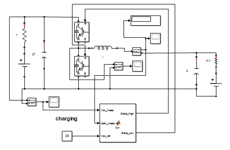
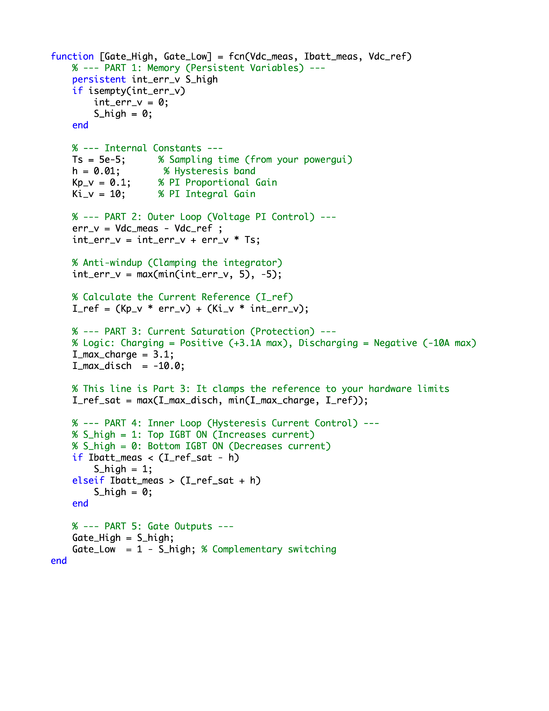

# 🔋 Battery Energy Storage System (BESS) & Two-Quadrant Chopper

> **Primary Subsystem Lead:** Abd El-Rhman Muhammad Saad  
> Core power electronics & control specialization within the B.Sc. graduation project (Alexandria University, 2026).

This directory contains analytical derivations, digital control design, and MATLAB/Simulink simulations for the **Two-Quadrant (2Q) Bidirectional DC-DC Chopper**. Within our Solar-Powered EV Charging Station, this power electronics interface acts as the central energy buffer between the 600V DC-Link and the Battery Energy Storage System (BESS).

The models document our full engineering lifecycle: from low-power open-loop hardware prototyping to full-scale closed-loop cascaded control, including discrete-time Z-domain transformation for embedded microcontroller deployment.

---

## ⚡ Bidirectional Operational Regimes & Power Flow

The Two-Quadrant Chopper controls bidirectional power flow through a split-leg configuration comprising two active switches (`Q1` High-Side, `Q2` Low-Side) and an interfacing power inductor (`L = 2 mH`):

```text
       [ 600V DC BUS ]
              │
         ┌────┴────┐
         │ Q1 (HS) │  (Buck Switch / Boost Diode)
         └────┬────┘
              ├───────────[ Inductor L ]───► [ BESS Battery Pack ]
         ┌────┴────┐
         │ Q2 (LS) │  (Boost Switch / Buck Diode)
         └────┬────┘
              │
          [ GROUND ]
```

### 1️⃣ Buck Mode (Battery Charging — Solar Surplus)

* **Trigger:** When solar PV generation exceeds EV load demand (`P_PV > P_EV`).
* **Operation:** The converter acts as a step-down regulator. The high-side switch `Q1` is driven by PWM duty cycle `D_ch`, while the anti-parallel diode of `Q2` provides the freewheeling path.
* **Governing Equation:**
  ```text
  V_batt = D_ch · V_DC
  ```
* **Current Convention:** Battery current is negative (entering the battery), clamped at our maximum safe continuous charge limit (`-3.1 A` on prototype).

### 2️⃣ Boost Mode (Battery Discharging — Solar Deficit)

* **Trigger:** When EV charging demand exceeds solar output (`P_PV < P_EV`), or during zero-solar night intervals.
* **Operation:** The converter operates as a step-up regulator. The low-side switch `Q2` is modulated with duty cycle `D_dis`, while `Q1` freewheels, stepping up battery potential to hold the DC bus at 600V.
* **Governing Equation:**
  ```text
  V_DC = V_batt / (1 - D_dis)
  ```
* **Current Convention:** Battery current is positive (discharging into the bus), providing up to `3.48 kW` of deficit support (`+10 A` limit on prototype).

### 3️⃣ Shoot-Through Protection:

A mandatory hardware dead-time (`t_dead ≈ 1 μs`) is embedded between complementary gate pulses to prevent simultaneous conduction across the high-voltage DC-link.

---

## 🧠 Digital Control Architecture & Z-Domain Discretization

The system utilizes a cascaded closed-loop control structure: an outer Voltage Loop (holding the 600V bus) and an inner Current Loop (tracking battery current with rapid dynamic response).

### 1. Continuous S-Domain Formulation:
The baseline PI controller is formulated in the continuous domain as:
```text
C(s) = K_p + (K_i / s)
```

### 2. Bilinear (Tustin) Transformation:
To deploy this controller on real hardware (Arduino Uno / ESP32) without numerical instability, the transfer function was mapped to the discrete z-domain using the Tustin approximation:
```text
s ≈ (2 / T_s) · [(1 - z^-1) / (1 + z^-1)]
```

Substituting into `C(s)` yields the discrete-time transfer function:
```text
C(z) = U(z) / E(z) = [(2·K_p + K_i·T_s) + (K_i·T_s - 2·K_p)·z^-1] / [2·(1 - z^-1)]
```

### 3. Difference Equation for Embedded Fixed-Point C++:
Expanding into the time-domain execution loop:
```text
u[k] = u[k-1] + a_0 · e[k] + a_1 · e[k-1]
```
Where:
```text
a_0 = K_p + (K_i · T_s / 2)
a_1 = -K_p + (K_i · T_s / 2)
```

*(This difference equation was implemented using fixed-point integer scaling on the microcontroller to avoid slow floating-point execution, ensuring a control execution loop well within the 10 kHz switching period).*

---

## 📊 Full-Scale System vs. Laboratory Prototype Sizing

| Engineering Parameter | Full-Scale Utility BESS | Scaled Laboratory Prototype |
| :--- | :---: | :---: |
| **Common DC Bus Potential** | 600.0 V | 12.0 V – 24.0 V |
| **Target Power Capacity** | Covers **3.48 kW** deficit | Validates safe 2S Li-ion pack dynamics |
| **Battery Chemistry** | Lithium-ion Battery Bank | 2S Li-ion pack (7.4 V nom. / 8.4 V max) |
| **Power Semiconductor** | High-Power IGBT / SiC Modules | IRFP260N Power MOSFETs (200V, 50A) |
| **Gate Driver Isolation** | High-Voltage Optocoupled Drivers | 6N139 / 6N137 Optocoupled IR2111 |
| **Switching Frequency** | 10 kHz | 10 kHz |
| **Inductor Sizing** | Power filter choke | 2.0 mH Iron-Core Inductor |
| **Current Limits** | Scaled pack bounds | -3.1 A (Charge) / +10.0 A (Discharge) |
| **Current Tracking Error** | < 2% | ≤ 5% (within 0.2 A – 0.4 A) |

---

## 📂 File Architecture & Verification Progression

The models capture our complete progressive verification workflow:

### Phase 1: Open-Loop Baseline Testing
* **`chopper_prototype_rating.slx`**: Open-loop testbench configured at low-power ratings. Validates gate switching logic, duty cycle sensitivity, and component thermal margins on our laboratory bench.
* **`chopper_actual_rating.slx`**: Open-loop model scaled up to high-voltage EV battery ratings, verifying converter passive sizing prior to closing feedback loops.

### Phase 2: Closed-Loop Control & Dynamic Validation
* **`Quadrant2chopper2.slx`**: Initial closed-loop testbench tuning the PI coefficients and validating isolated charging or discharging steps.
* **`final2q_all_cases.slx`**: The comprehensive, production-grade closed-loop model. Simulates dynamic transitions between charging (buck mode) and discharging (boost mode), enforcing current saturation limits and verifying DC bus stability.

---

## 🏗️ System Architecture & Code Implementation

**Two-Quadrant Chopper Closed-Loop Model (`final2q_all_cases.slx`):**  


**Embedded Control State Machine & Limits:**  
The MATLAB Function block below illustrates the inner current tracking and strict saturation bounds (-3.1 A charging, +10 A discharging):  


---

## 📈 Experimental Simulation Results

The scope capture below verifies seamless bidirectional transitions. As power balance shifts, the battery current dynamically reverses direction across the zero-axis while holding the DC-Link voltage tightly regulated:


---

## 🔧 How to Run
1. Open MATLAB and navigate to `3_BESS_and_2Q_Chopper/`.
2. Open `final2q_all_cases.slx` to inspect full closed-loop bidirectional operation.
3. Run the simulation and observe the Scope blocks to verify current reversal dynamics and DC bus regulation during charging and discharging transients.
