# 🚙 EV Buck Charger: Power Stage, Hardware Prototyping & Closed-Loop CC/CV Control

This repository directory contains the analytical derivations, hardware parasitic calculations, and MATLAB/Simulink models for the **DC-DC Step-Down (Buck) Converter** stage. Within our Solar-Powered EV Charging Station, this power electronics interface steps down the regulated 600V DC-Link bus to safely and efficiently charge the Electric Vehicle (EV) battery pack.

The documentation captures our complete engineering lifecycle: from high-power open-loop steady-state sizing to laboratory hardware prototyping under parasitic losses, culminating in the closed-loop **Constant-Current / Constant-Voltage (CC/CV)** battery charging profile.

---

## 📂 File Architecture & Simulation Manifest

| Simulation Model | Operational Mode | Power & Voltage Ratings | Primary Engineering Objective |
| :--- | :---: | :---: | :--- |
| **`Buck_Power_Stage_Open_Loop.slx`** | Open-Loop | $V_{in} = 600\text{ V} \to V_o = 400\text{ V}$ ($50\text{ kW}$) | High-power converter stage sizing, continuous conduction mode (CCM), and ripple limits. |
| **`Buck_Prototype_Current_Control.slx`** | Closed-Loop | $V_{in} = 10\text{ V} \to I_{ref} = 0.74\text{ A}$ ($10\text{ kHz}$) | Prototype-scale current regulation using a discrete PI controller and sawtooth PWM generator. |
| **`Buck_Closed_Loop_CCCV_Charger.slx`** | Closed-Loop | $V_{in} = 600\text{ V} \to V_{batt} = 380\text{ V} / 420\text{ V}$ | Full multi-stage battery charging model with automated CC-to-CV transition logic. |

---

## 📐 Non-Ideal Circuit Modeling & Parasitic Compensation

In practical power electronics, theoretical duty cycles derived from ideal switches fail to achieve target output voltages due to internal semiconductor drops and parasitic line resistances. As derived in Section 6.3 of our project thesis, the hardware prototype incorporates measured non-idealities:

* Inductor DC winding resistance: $r_L = 1.9\ \Omega$
* Output capacitor Equivalent Series Resistance (ESR): $r_C = 0.2\ \Omega$
* Power MOSFET on-resistance: $r_{DS(on)} = 0.025\ \Omega$
* Freewheeling diode forward voltage drop: $V_{fwd} = 0.8\text{ V}$
* Switching frequency: $f_{sw} = 10\text{ kHz}$

### Non-Ideal Duty Cycle Derivation ($D_u$):
Applying volt-second balance across the inductor over a complete switching period ($T_{sw}$) yields:

$$
D_u = \frac{V_{fwd} + I_L \cdot r_L + V_o}{V_{in} - I_L \cdot r_{DS(on)} + V_{fwd}}
$$

For our hardware operating point ($V_{in} = 12.3\text{ V}$, $V_o = 3.7\text{ V}$, $R_{load} = 10\ \Omega \implies I_L = 0.37\text{ A}$):

$$
D_u = \frac{0.8 + (0.37 \cdot 1.9) + 3.7}{12.3 - (0.37 \cdot 0.025) + 0.8} = \frac{5.203}{13.09075} \approx \mathbf{39.75\%}
$$

*(Compared to an ideal duty cycle of $D_{ideal} = \frac{3.7}{12.3} \approx 30.08\%$, the additional $9.67\%$ duty cycle directly compensates for device internal conduction losses).*

### Minimum Component Sizing & Hardware Margin:
Allowing an inductor current ripple target $\Delta I_L = 0.222\text{ A}$ ($60\%$ of average current) and an output voltage ripple target $\Delta V_o = 0.074\text{ V}$ ($2\%$ ripple tolerance):

$$
L_{min} = \frac{\left[V_{in} - I_L(r_{DS(on)} + r_L) - V_o\right] \cdot D_u}{\Delta I_L \cdot f_{sw}} \approx 1.412\text{ mH} \implies \text{Selected Hardware: } \mathbf{2.0\ mH}
$$

$$
C_{min} = \frac{\Delta I_L}{8 \cdot \Delta V_o \cdot f_{sw}} = \frac{0.222}{8 \cdot 0.074 \cdot 10000} \approx 37.5\ \mu\text{F} \implies \text{Selected Hardware: } \mathbf{200\ \mu F}
$$

---

## 🧠 Closed-Loop CC/CV Battery Charging Control

Lithium-ion battery charging requires two distinct operational regimes to maximize energy intake while preventing cell overheating and chemical degradation:

| Charging Regime | Operational Condition | Control Objective | Terminal Dynamics |
| :--- | :--- | :--- | :--- |
| **Constant Current (CC)** | $V_{batt} < 420.0\text{ V}$ | Inner current PI loop regulates charging current at rated limit ($I_{rated} = -50\text{ A}$). | Terminal voltage rises steadily as bulk capacity is replenished. |
| **Constant Voltage (CV)** | $V_{batt} \ge 420.0\text{ V}$ | Outer voltage PI loop clamps terminal voltage strictly at $420.0\text{ V}$. | Charging current decays exponentially; cutoff occurs as battery reaches full capacity. |

---

## 1️⃣ High-Power Open-Loop Stage (`Buck_Power_Stage_Open_Loop.slx`)

This model evaluates the baseline continuous conduction step-down capability from the 600V DC-Link bus delivering 50 kW to a resistive load ($V_{in} = 600\text{ V}$, $V_o = 400\text{ V}$, $L = 1\text{ mH}$, $C = 470\ \mu\text{F}$, $R = 3.2\ \Omega$):

### System Architecture:

  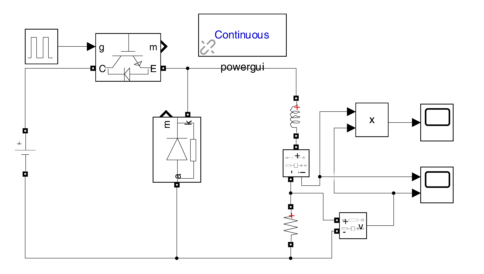

### Voltage, Current, and Power Waveforms:
The zoomed waveforms confirm that inductor current ripple remains well within the design threshold ($\Delta I_L \le 20\%$):

| Output Voltage & Current | Inductor Current Continuity (Zoomed) |
| :---: | :---: |
| 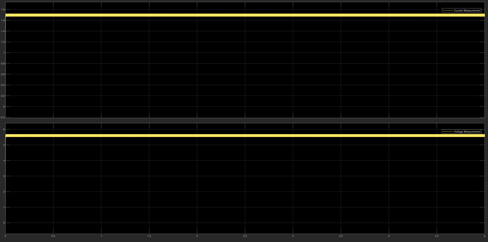 | 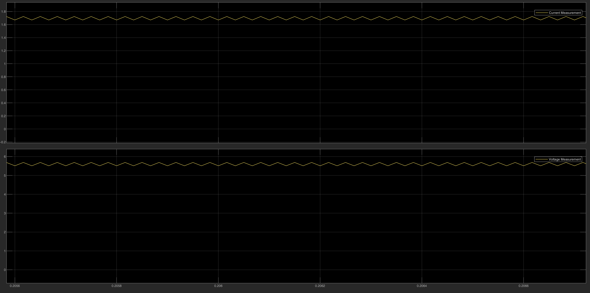 |

| Output Power Delivery | Zoomed Power Delivery |
| :---: | :---: |
|  | 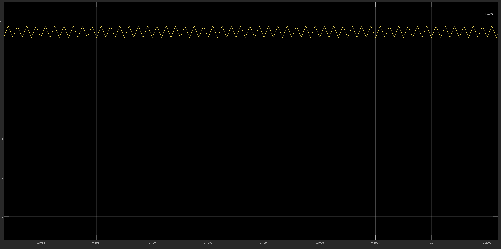 |

---

## 2️⃣ Prototype Closed-Loop Current Control (`Buck_Prototype_Current_Control.slx`)

Operating at the hardware laboratory testbench scale ($V_{in} = 10\text{ V}$, $I_{ref} = 0.74\text{ A}$, $f_{sw} = 10\text{ kHz}$, $R_{load} = 10.2\ \Omega$), this model validates feedback current regulation:

### Parameters & Controller Tuning:
* **Current Reference ($I_{ref}$):** $0.74\text{ A}$ (2S Li-ion nominal charging current)
* **Voltage Reference ($V_{ref}$):** $7.4\text{ V}$ ($2 \times 3.7\text{ V}$)
* **PI Current Controller:** $K_p = 0.009186, \quad K_i = 18.27$
* **PI Voltage Controller:** $K_p = 0.009529, \quad K_i = 21.61$

### System Architecture & Control Loop:
The control block senses the inductor current, computes the error against $I_{ref}$, processes it through the tuned PI controller, and outputs the modulating duty cycle:

| Full System Schematic | PI Control Loop Subsystem |
| :---: | :---: |
| 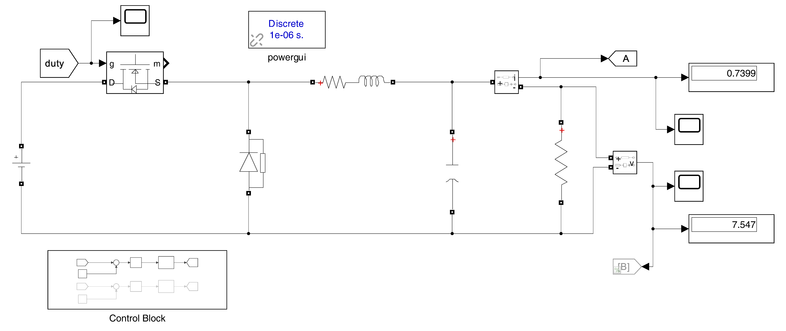 | 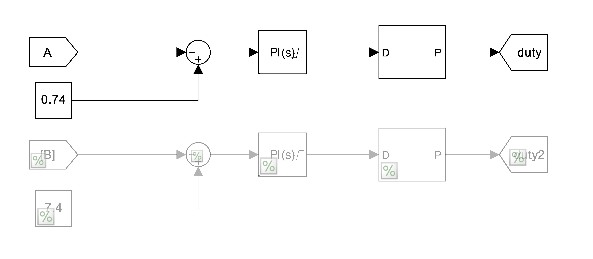 |

### 10 kHz Sawtooth PWM Generation:
The calculated control command is compared against a 10 kHz carrier to generate clean gate pulses with controlled rise and fall times:

| PWM Carrier Generator | Zoomed Gate Signal Pulse |
| :---: | :---: |
|  | 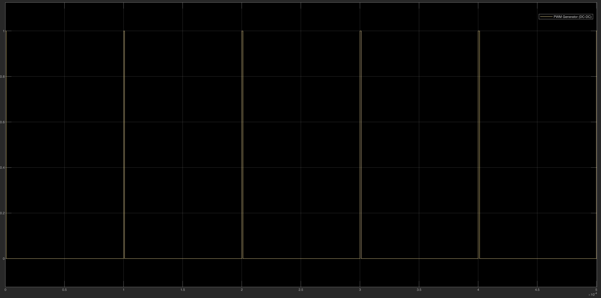 |

### Closed-Loop Dynamic Tracking Results:
The PI loop achieves rapid reference tracking, settling at $0.74\text{ A}$ within $\approx 0.3\text{ s}$ with zero steady-state error, establishing $7.547\text{ V}$ across the test load:

| Regulated Current Response ($0.74\text{ A}$) | Terminal Voltage Response ($7.5\text{ V}$) |
| :---: | :---: |
| 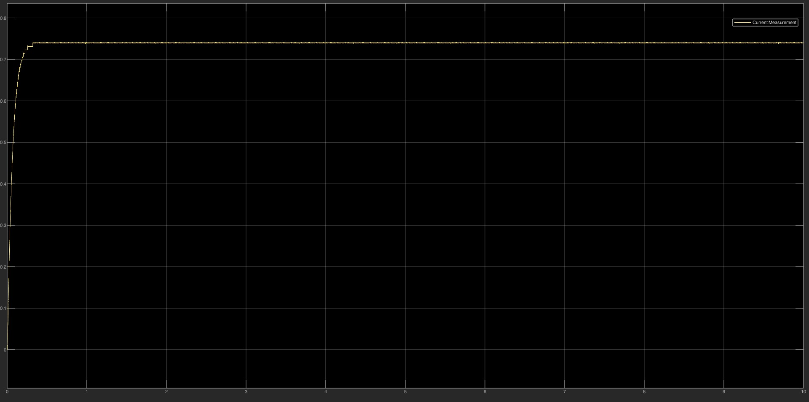 | 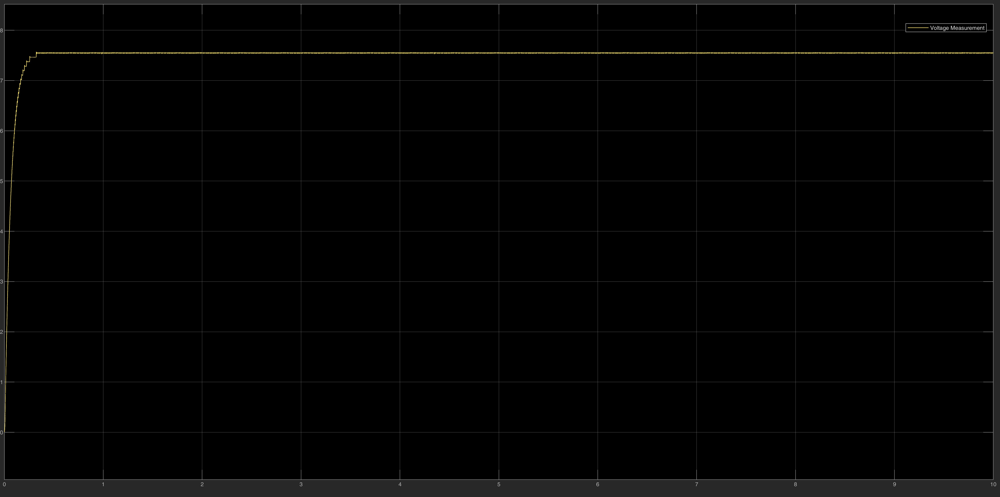 |

---

## 3️⃣ Full Closed-Loop CC/CV Battery Charging (`Buck_Closed_Loop_CCCV_Charger.slx`)

This advanced model simulates the complete lithium-ion battery pack charging dynamics fed from the 600V bus:
* **Cascaded Control Topology:** Outer voltage PI loop (regulating to $420\text{ V}$) cascaded into a saturated inner current PI loop (clamped at $-50\text{ A}$ continuous charge current).
* **Autonomous Regime Transfer:** Starts in Constant-Current (CC) mode injecting $-50\text{ A}$; upon reaching $420.0\text{ V}$ ($t = 6.2\text{ s}$), the control seamlessly transitions into Constant-Voltage (CV) mode, clamping the voltage while charging current decays toward zero as the State of Charge (SoC) approaches $100\%$.

### Multi-Stage CC/CV Simulink Schematic:

  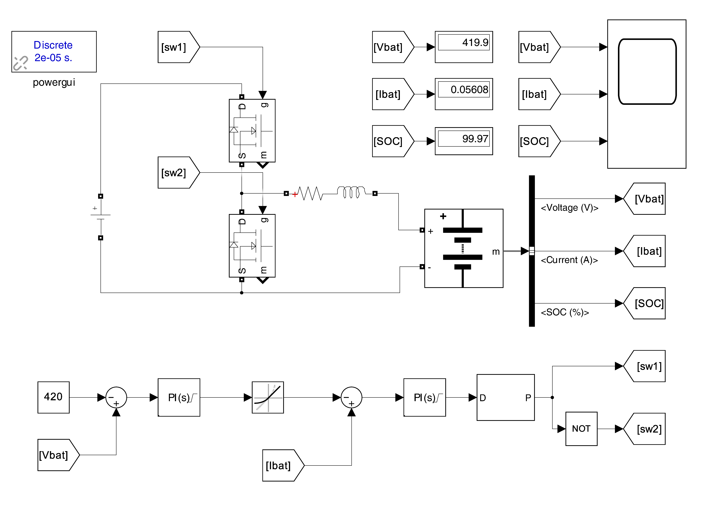

### Complete CC/CV Dynamic Waveforms:
The scopes below demonstrate the full charging cycle from initial current injection to voltage clamping and exponential current decay:

| Annotated CC/CV Charging Cycle ($0 - 15\text{ s}$) | Raw Simulink Measurement Scope |
| :---: | :---: |
|  | 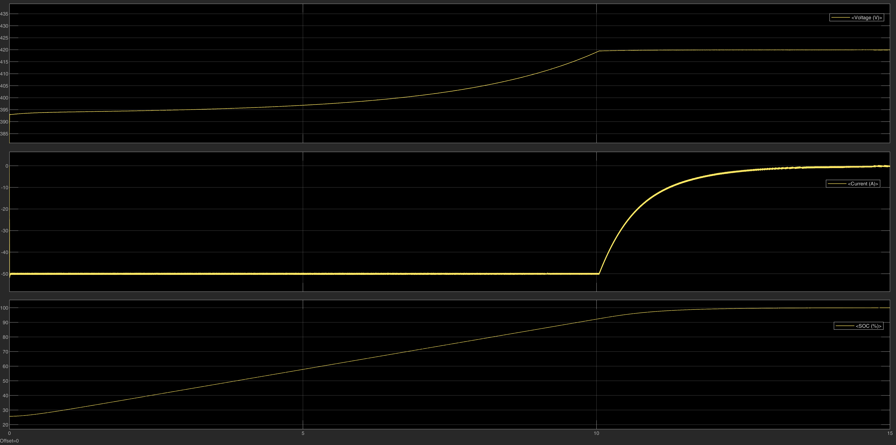 |

---

## 🔧 How to Run
1. Open MATLAB and navigate to `4_EV_Buck_Charger/`.
2. **High-Power Verification:** Open `Buck_Power_Stage_Open_Loop.slx` and run the simulation to inspect 600V-to-400V step-down dynamics and power delivery.
3. **Hardware-Scale Current Tracking:** Open `Buck_Prototype_Current_Control.slx` and verify that the PI controller locks the current to $0.74\text{ A}$ with stable PWM switching.
4. **Full CC/CV Battery Charging:** Open `Buck_Closed_Loop_CCCV_Charger.slx` to observe the autonomous transition from constant-current charging to constant-voltage clamping.