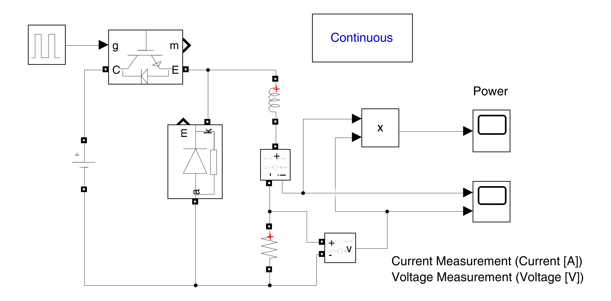
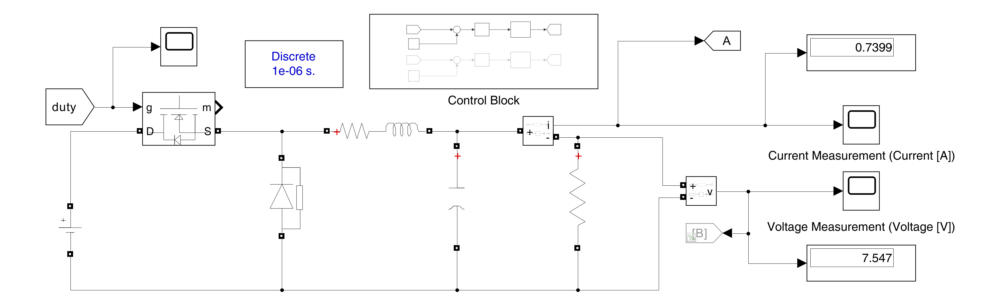
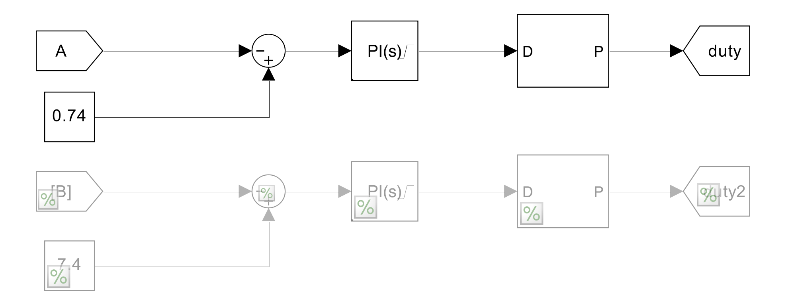
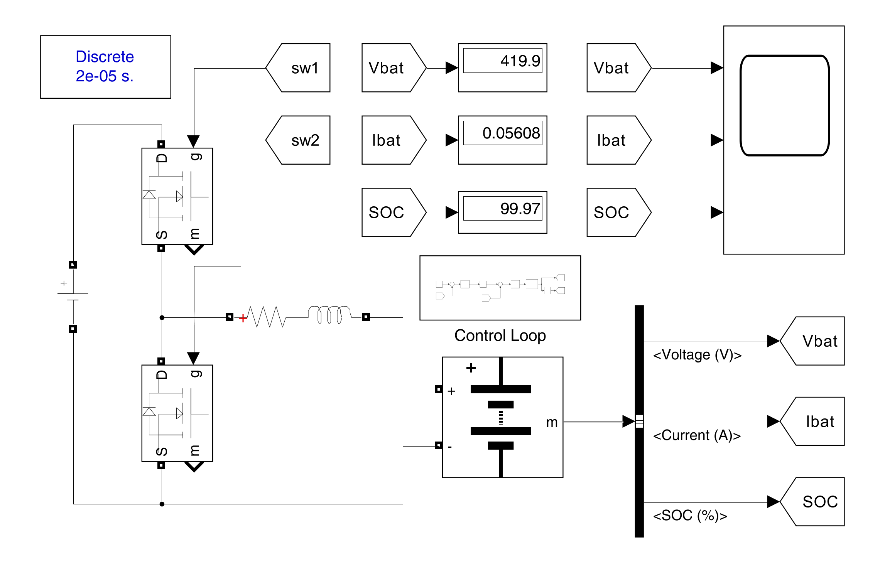
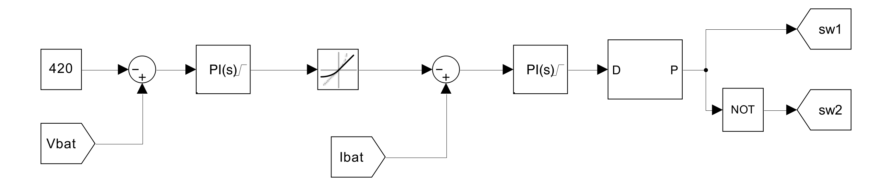
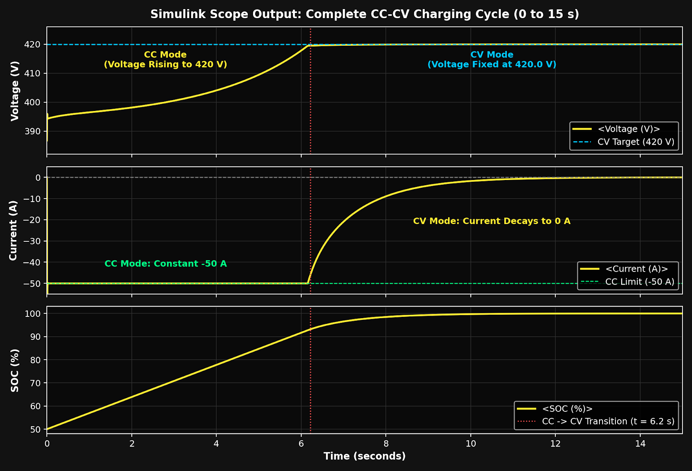
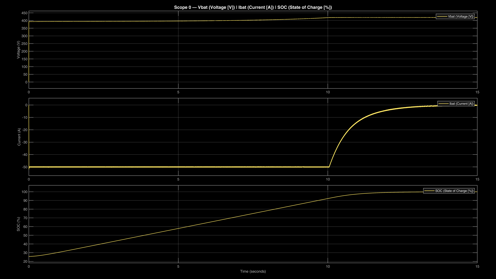
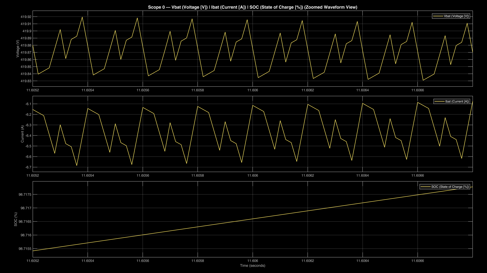

# 🚗 EV Buck Charger: Power Stage, Hardware Prototyping & Closed-Loop CC/CV Control

> **Team Project:** Solar-Powered EV Charging Station with BESS (8-member team) — *documentation by Abd El-Rhman Muhammad Saad*  
> **Academic Institution:** Faculty of Engineering, Alexandria University (Class of 2026)  
> **Department:** Electrical Power and Machines Engineering  
> **Core Focus:** Step-Down Power Stage Sizing, Measured Parasitic Compensation, Discrete PI Current Control & Automated CC/CV State Logic

---

## 📌 Executive Summary & Microgrid Operational Role

In the Solar-Powered EV Charging Station microgrid, the **DC-DC Step-Down (Buck) Converter** serves as the regulated power interface between the central $600.0\text{ V}$ DC-link bus and the Electric Vehicle (EV) battery pack. Its operational mandate is to execute safe, highly efficient energy transfer while enforcing a rigorous **Constant-Current / Constant-Voltage (CC/CV)** battery charging protocol.

The technical documentation and simulation models capture the complete engineering progression:
1. **Utility-Scale Open-Loop Stage ($50\text{ kW}$):** Continuous Conduction Mode (CCM) verification, component sizing, and passive ripple filtering from $600.0\text{ V}$ down to $400.0\text{ V}$.
2. **Laboratory Prototype Current Regulation:** Discrete-time PI current controller operating at $10\text{ kHz}$, incorporating real-world semiconductor drops and measured parasitic resistances.
3. **Full Multi-Stage Automated CC/CV Charger:** Supervisory state-machine logic executing automatic mode transitions to maximize battery lifespan and limit overcharging.

### File Architecture & Simulation Manifest

| Simulation Model | Operational Mode | Power & Voltage Ratings | Primary Engineering Objective |
| :--- | :---: | :---: | :--- |
| **`Buck_Power_Stage_Open_Loop.slx`** | Open-Loop | $V_{\text{in}} = 600\text{ V} \to V_o = 400\text{ V}$ ($50\text{ kW}$) | High-power converter stage sizing, continuous conduction mode (CCM), and ripple limits. |
| **`Buck_Prototype_Current_Control.slx`** | Closed-Loop | $V_{\text{in}} = 10\text{ V} \to I_{\text{ref}} = 0.74\text{ A}$ ($10\text{ kHz}$) | Prototype-scale current regulation using a discrete PI controller and sawtooth PWM generator. |
| **`Buck_Closed_Loop_CCCV_Charger.slx`** | Closed-Loop | $V_{\text{in}} = 600\text{ V} \to V_{\text{batt}} = 380\text{ V} / 420\text{ V}$ | Full multi-stage battery charging model with automated CC-to-CV transition logic. |

---

## 📐 Non-Ideal Circuit Modeling & Parasitic Compensation

In practical power electronics, theoretical duty cycles derived from idealized components fail to achieve the required output voltage due to internal semiconductor voltage drops and parasitic winding resistances. During laboratory bench testing (detailed in Chapter 6 of the thesis), our hardware prototype was parameterized with measured non-idealities:

* Inductor DC winding resistance: $r_L = 1.9\ \Omega$
* Output capacitor Equivalent Series Resistance (ESR): $r_C = 0.2\ \Omega$
* Power MOSFET on-state channel resistance: $r_{\text{DS(on)}} = 0.025\ \Omega$
* Freewheeling diode forward voltage drop: $V_{\text{fwd}} = 0.8\text{ V}$
* Nominal switching frequency: $f_{\text{sw}} = 10\text{ kHz}$

### Non-Ideal Duty Cycle Derivation ($D_u$)

Applying volt-second balance across the energy storage inductor over a complete switching period ($T_{\text{sw}}$) under non-ideal conduction losses:

$$\int_{0}^{T_{\text{sw}}} v_L(t)\, dt = 0$$

During the switch ON-interval ($0 \le t \le D_u T_{\text{sw}}$):
$$v_{L,\text{on}} = V_{\text{in}} - I_L \cdot r_{\text{DS(on)}} - I_L \cdot r_L - V_o$$

During the switch OFF-interval ($D_u T_{\text{sw}} \le t \le T_{\text{sw}}$):
$$v_{L,\text{off}} = -(V_o + I_L \cdot r_L + V_{\text{fwd}})$$

Equating the volt-second integrals:
$$\left[V_{\text{in}} - I_L \cdot r_{\text{DS(on)}} - I_L \cdot r_L - V_o\right] D_u - \left[V_o + I_L \cdot r_L + V_{\text{fwd}}\right] (1 - D_u) = 0$$

Solving analytically for the non-ideal duty cycle ($D_u$):

$$D_u = \frac{V_{\text{fwd}} + I_L \cdot r_L + V_o}{V_{\text{in}} - I_L \cdot r_{\text{DS(on)}} + V_{\text{fwd}}}$$

For our laboratory prototype operating point ($V_{\text{in}} = 12.3\text{ V}$, $V_o = 3.7\text{ V}$, $R_{\text{load}} = 10\ \Omega \implies I_L = 0.37\text{ A}$):

$$D_u = \frac{0.8 + (0.37 \cdot 1.9) + 3.7}{12.3 - (0.37 \cdot 0.025) + 0.8} = \frac{5.203}{13.09075} \approx \mathbf{39.75\%}$$

> **Engineering Note on Conduction Drops:** Compared to an idealized duty cycle of $D_{\text{ideal}} = \frac{3.7}{12.3} \approx 30.08\%$, the actual required duty cycle is $39.75\%$. The additional $+9.67\%$ pulse width directly compensates for the forward barrier drop of the freewheeling diode and the $I^2 R$ copper losses in the inductor winding.

### Minimum Component Sizing & Hardware Margin

To ensure Continuous Conduction Mode (CCM) with an inductor current ripple target $\Delta I_L = 0.222\text{ A}$ (60% of average inductor current) and an output voltage ripple target $\Delta V_o = 0.074\text{ V}$ (2% ripple tolerance):

$$L_{\text{min}} = \frac{\left[V_{\text{in}} - I_L(r_{\text{DS(on)}} + r_L) - V_o\right] \cdot D_u}{\Delta I_L \cdot f_{\text{sw}}} \approx 1.412\text{ mH} \implies \text{Selected Hardware: } \mathbf{2.0\text{ mH}}$$

$$C_{\text{min}} = \frac{\Delta I_L}{8 \cdot \Delta V_o \cdot f_{\text{sw}}} = \frac{0.222}{8 \cdot 0.074 \cdot 10000} \approx 37.5\ \mu\text{F} \implies \text{Selected Hardware: } \mathbf{200\ \mu\text{F}}$$

---

## 🔋 Closed-Loop CC/CV Battery Charging Control

Lithium-ion vehicle traction packs require two distinct charging phases to ensure maximum energy density while preventing cell thermal degradation:

| Charging Regime | Operational Condition | Control Objective | Terminal Dynamics |
| :--- | :--- | :--- | :--- |
| **Constant Current (CC)** | $V_{\text{batt}} < 420.0\text{ V}$ | Inner current PI loop regulates charging current at rated limit ($I_{\text{rated}} = -50\text{ A}$). | Terminal voltage rises steadily as bulk capacity is replenished. |
| **Constant Voltage (CV)** | $V_{\text{batt}} \ge 420.0\text{ V}$ | Outer voltage PI loop clamps terminal voltage at $420.0\text{ V}$. | Charging current decays exponentially; cutoff occurs as battery reaches full capacity. |

### CC-to-CV Supervisory Transition Logic

The mode switchover is governed by an automated state comparator with saturation clamping:

$$I_{\text{ref}} = \begin{cases} I_{\text{rated}} & \text{if } V_{\text{batt}} < 420.0\text{ V} \quad (\text{CC Mode}) \\[6pt] \text{PI}_v(420.0 - V_{\text{batt}}) & \text{if } V_{\text{batt}} \ge 420.0\text{ V} \quad (\text{CV Mode}) \end{cases}$$

The inner current loop compares $I_{\text{ref}}$ against measured battery current $I_{\text{batt}}$, and the resulting control effort is modulated via a $10\text{ kHz}$ discrete PWM generator driving the high-side power switch.

---

## 📐 Architecture Schematics & Waveform Verification

### 1. High-Power Open-Loop Power Stage (50 kW)
Sizing model validating $600\text{ V} \to 400\text{ V}$ continuous conduction mode and passive filtering:

<p align="center">
  
</p>

### 2. Prototype-Scale Closed-Loop Current Control Model
Laboratory-scaled model regulating charging current under measured parasitic impedances:

<p align="center">
  
</p>

### 3. Prototype PI Current Regulation Loop
Subsystem view showing the discrete PI regulator, feedback current sensing, and PWM generator:

<p align="center">
  
</p>

### 4. Full Multi-Stage Closed-Loop CC/CV Charger Architecture
Top-level microgrid simulation interfacing the $600\text{ V}$ DC bus with the dynamic battery load:

<p align="center">
  
</p>

### 5. Dual-Loop CC/CV Control Subsystem
Supervisory state logic that monitors terminal voltage and smoothly hands over control from CC to CV:

<p align="center">
  
</p>

### 6. Complete Dynamic CC/CV Charging Cycle (Annotated Overview)
Shows terminal voltage climbing to $420.0\text{ V}$, the automatic transition point ($t = 6.2\text{ s}$), and subsequent current decay:

<p align="center">
  
</p>

### 7. High-Resolution 300 DPI Multi-Subplot Battery Dynamics
Full-scale telemetry displaying instantaneous battery voltage ($V_{\text{bat}}$), charging current ($I_{\text{bat}}$), and State of Charge ($SOC$):

<p align="center">
  
</p>

### 8. Zoomed Waveform View in CV Mode
Close-up transient scope showing sub-$0.1\text{ V}$ voltage ripple and stable current regulation:

<p align="center">
  
</p>

---

## 📂 Directory Structure & Simulation Execution Guide

```text
4_EV_Buck_Charger/
├── README.md                                          # Master engineering documentation & parasitic report
├── Buck_Power_Stage_Open_Loop.slx                     # High-power 50 kW open-loop sizing model
├── Buck_Prototype_Current_Control.slx                 # Scaled prototype closed-loop current control model
├── Buck_Closed_Loop_CCCV_Charger.slx                  # Full-scale multi-stage CC/CV battery charger model
└── images/                                            # 300 DPI high-resolution architecture & scope assets
    ├── Buck_CCCV_Scope.png
    ├── buck_cccv_control_loop_300dpi.png
    ├── buck_cccv_dynamic_curves_300dpi.png
    ├── buck_cccv_full_system_300dpi.png
    ├── buck_cccv_zoomed_ripple_300dpi.png
    ├── buck_open_loop_power_stage_300dpi.png
    ├── buck_prototype_control_loop_300dpi.png
    └── buck_prototype_current_control_300dpi.png
```

### Steps to Run the Charging Models

1. **Prerequisites:** Open MATLAB/Simulink R2022b or later with Simscape Electrical.
2. **Execute Full CC/CV Simulation:**
   * Open `Buck_Closed_Loop_CCCV_Charger.slx`.
   * Click **Run** (`Ctrl+T`). Simulation duration is configured for $15.0\text{ s}$.
   * Double-click the main Scope block to observe the transition from Constant Current ($-50.0\text{ A}$) to Constant Voltage ($420.0\text{ V}$) at $t \approx 6.2\text{ s}$.
3. **Inspect Prototype Closed-Loop Current Control:**
   * Open `Buck_Prototype_Current_Control.slx`.
   * Verify how the discrete PI controller adjusts duty cycle to track the $0.74\text{ A}$ current setpoint under line resistance variations.
4. **Solver Recommendations:**
   * Solver: `Discrete (no continuous states)`.
   * Sample Time: $T_s = 1.0\ \mu\text{s}$ for high-power switching; $T_s = 50\ \mu\text{s}$ for supervisory control loops.
