# 🛠️ Hardware Prototyping & PCB Design

> **Project Engineer:** Abd El-Rhman Muhammad Saad  
> **Academic Institution:** Faculty of Engineering, Alexandria University (Class of 2026)  
> **Department:** Electrical Power and Machines Engineering  
> **Core Focus:** Altium PCB Design, High-Power Layout Integrity, ATmega328P Timer 1 Firmware & Bench Instrumentation Testing

---

## 📌 Executive Summary & Architecture

This directory contains the Electronic Design Automation (EDA) project files, fabrication data, bill of materials, and laboratory experimental validation for the physical prototypes of the **Solar-Powered EV Charging Station with BESS**. All converter power stages and control interfaces were transitioned from MATLAB/Simulink mathematical models into functional printed circuit boards designed in **Altium Designer** and verified under rigorous bench-testing conditions.

The hardware implementation bridges the gap between numerical simulation and practical power engineering. The design encompasses three dedicated converter stages:

1. **Two-Quadrant (2Q) Bidirectional Chopper:** Interfaces the 7.4 V / 2.55 Ah Battery Energy Storage System (BESS) with the DC bus, managing synchronous bidirectional power flow (Buck charging / Boost discharging).
2. **Synchronous EV Buck Charger:** Implements closed-loop Constant Current / Constant Voltage (CC-CV) battery charging for the EV battery pack with fast dynamic response and high conversion efficiency.
3. **Interleaved Boost Converter:** Multi-phase boost topology designed to interface high-current low-voltage PV generation with the common DC bus while drastically reducing input current ripple.

### Hardware Archive Packages

| Archive Name | Target Topology | EDA Tool | Contents Included |
| :--- | :--- | :--- | :--- |
| **`Two_Quadrant_Chopper.zip`** | Bidirectional 2Q Chopper | Altium Designer | `.SchDoc`, `.PcbDoc`, Gerbers, NC Drill, Pick-and-Place |
| **`Buck_Converter.zip`** | Synchronous Buck Power Stage | Altium Designer | Complete Schematic, Layout, BOM, Fabrication Outputs |
| **`Interleaved_Thevenin.zip`** | 2-Phase Interleaved Boost | Altium Designer | Dual-phase layout, Inductor footprints, Gate routing |

---

## 📐 Electronic Design Automation (Altium Designer Workflow)

The hardware design process follows standard industrial power electronics EDA standards:

* **Schematic Capture (`.SchDoc`):** Hierarchical schematic structure isolating the high-voltage/high-current power stage from the sensitive low-voltage analog sensing and digital PWM control domains.
* **PCB Layout Routing (`.PcbDoc`):** Double-sided FR-4 substrate ($1.6\text{ mm}$ thickness, $1\text{ oz}$ outer copper weight) optimized for minimum parasitic inductance and high thermal dissipation.
* **Manufacturing & CAM (`CAMtastic`):** Standard RS-274X Gerber files, NC Drill files, and solder mask/paste layers ready for bare-board fabrication.

### Altium Schematic Architecture
Detailed circuit design showing the gate-drive optocoupler isolation stage, bootstrap circuitry, half-bridge MOSFET leg, and analog sensing connections:

<p align="center">
  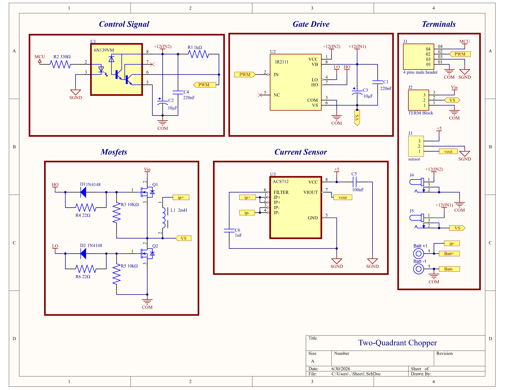
</p>

### Altium 3D Isometric Board Layout
3D CAD rendering of the fabricated two-quadrant board displaying component placement, toroidal inductors, radial electrolytic filter capacitors, and heatsink mounting:

<p align="center">
  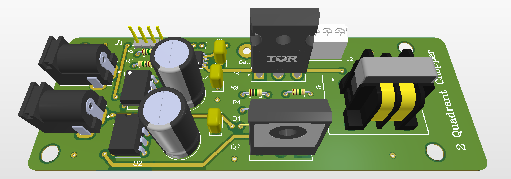
</p>

---

## ⚡ High-Power PCB Layout & Signal Integrity Guidelines

Designing PCBs for high-frequency switching converters ($10\text{ kHz}$ to $100\text{ kHz}$) operating with inductive loads demands strict layout discipline to mitigate electromagnetic interference (EMI) and parasitic oscillations:

1. **Star Grounding Strategy (Single-Point Ground):**
   * Strict physical segregation between **Power Ground (PGND)** carrying high-current switching pulses and **Signal Ground (AGND/DGND)** used by the microcontroller and analog sensors.
   * Both ground domains meet at a single physical point (near the bulk filter capacitor return) to prevent ground loops from injecting switching noise into ADC readings.

2. **Gate Driver Loop Inductance Minimization:**
   * High $di/dt$ gate drive loops between the **IR2111** driver output, MOSFET gate, and source terminal were routed using short, wide, parallel traces to minimize parasitic inductance ($L_{\text{gate}}$).
   * A dedicated damping gate resistor ($22\ \Omega$) is placed immediately adjacent to the MOSFET gate pin to suppress ringing caused by gate capacitance ($C_{\text{iss}}$) and trace inductance.

3. **Thermal Management & Low-ESR Polygon Pours:**
   * High-current conduction paths feature broad polygon copper pours rather than narrow traces, drastically lowering Equivalent Series Resistance (ESR) and eliminating thermal hotspots.
   * Heavy-duty TO-247 packages are heatsink-mounted to maintain thermal stability during sustained high-current testing.

4. **Galvanic Isolation & Noise Decoupling:**
   * High-speed optocouplers (**6N139**) provide up to $5000\text{ V}_{\text{RMS}}$ electrical isolation between the digital controller and high-voltage power semiconductor switches.
   * Dedicated $100\text{ nF}$ ceramic decoupling capacitors are positioned directly adjacent to IC power supply pins to suppress high-frequency transient ripple.

---

## 🔬 Laboratory Testbed & Instrumentation Setup

To validate converter topologies under real operating dynamics, a dedicated hardware testbed was assembled and wired in the electrical machines laboratory:

### Core Laboratory Equipment Specifications

| Equipment Description | Model / Tool Identifier | Operational Specifications | Role in Testbed |
| :--- | :--- | :--- | :--- |
| **Digital Storage Oscilloscope** | Tektronix TBS1000 Series | $100\text{ MHz}$ Bandwidth, $1\text{ GS/s}$ | PWM gate waveform, switching transient & ripple capture |
| **High-Precision Multimeter** | UNI-T UT89X / UT33D+ | True RMS, DC Current up to $20\text{ A}$ | Bench DC voltage and closed-loop current verification |
| **Regulated DC Power Supply** | Long-Wei DC Bench Supply | $0 - 30\text{ V}$, $0 - 10\text{ A}$ Adjustable | Emulated DC bus and laboratory power source |
| **Stationary Battery Pack** | 2S Li-ion (ICR18650 Pack) | $7.4\text{ V}$ Nominal, $2.55\text{ Ah}$ Capacity | Physical energy storage device under test |
| **Battery Management System** | HW-391 2S 20A Li-ion BMS | Overcharge ($8.4\text{ V}$), Undercharge ($6.0\text{ V}$) | Cell protection against thermal and electrical runaway |
| **Microcontroller Platform** | ATmega328P (Arduino Uno) | $16\text{ MHz}$ Crystal, 16-bit Timer 1 | Real-time discrete PI current controller execution |

### Assembled & Soldered 2Q Chopper PCB
Physical fabricated hardware board showing soldered power semiconductors, toroidal choke, and terminal blocks:

<p align="center">
  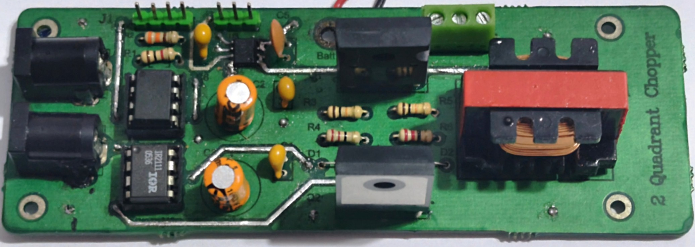
</p>

### Complete Laboratory Experimental Bench Setup
Full hardware integration featuring DC power supplies, oscilloscope probing, multimeter telemetry, and battery load:

<p align="center">
  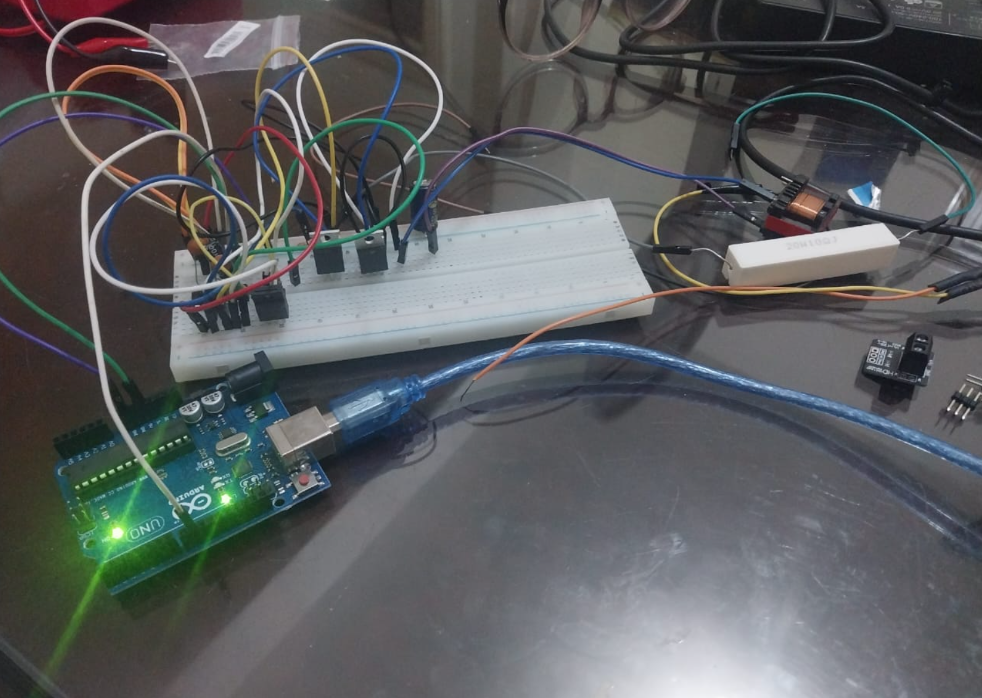
</p>

---

## 📋 Comprehensive Bill of Materials (BOM) & Component Specifications

| Component Tag | Component Description | Manufacturer Part | Package | Electrical Rating / Spec | Quantity |
| :---: | :--- | :--- | :---: | :--- | :---: |
| **Q1, Q2** | Power N-Channel MOSFET | IRFP260N | TO-247AC | $200\text{ V}$, $50\text{ A}$, $R_{\text{DS(on)}} = 0.04\ \Omega$ | 2 |
| **U1** | High-Speed Optocoupler | 6N139 | DIP-8 | $5000\text{ V}_{\text{RMS}}$ Isolation, $100\text{ kBd}$ | 1 |
| **U2** | Half-Bridge Gate Driver | IR2111 | DIP-8 | High/Low Driver with $650\text{ ns}$ Internal Dead-time | 1 |
| **U3** | Linear Hall Current Sensor | ACS712ELCTR-05B-T | SOIC-8 | $\pm 5\text{ A}$ Range, $185\text{ mV/A}$ Sensitivity | 1 |
| **L1** | Power Energy Storage Inductor | Toroidal Power Choke | Through-Hole | $2.0\text{ mH}$, $10\text{ A}_{\text{DC}}$ Saturation Current | 1 |
| **C1, C4** | Film Decoupling Capacitor | Metallized Polyester | Radial | $220\text{ nF}$, $100\text{ V}$ Rating | 2 |
| **C2** | Electrolytic Filter Capacitor | Low-ESR Radial | Radial | $200\ \mu\text{F}$, $50\text{ V}$ Working Voltage | 1 |
| **C3** | Bootstrap Capacitor | Tantalum / Electrolytic | Radial | $10\ \mu\text{F}$, $25\text{ V}$ | 1 |
| **D1, D2** | Ultrafast Switching Diode | 1N4148 | DO-35 | $100\text{ V}$, $200\text{ mA}$, $t_{\text{rr}} \le 4\text{ ns}$ | 2 |
| **R4, R6** | Gate Damping Resistor | Metal Film Resistor | Axial | $22\ \Omega$, $0.25\text{ W}$, $1\%$ Tolerance | 2 |
| **R3, R5** | Gate Pull-Down Resistor | Carbon Film Resistor | Axial | $10\text{ k}\Omega$, $0.25\text{ W}$ | 2 |
| **BMS** | Battery Protection Board | HW-391 2S 20A BMS | PCB Module | Overcharge: $8.4\text{ V}$, Cutoff: $6.0\text{ V}$ | 1 |
| **BATT** | 2S Li-ion Battery Pack | ICR18650 Cells | 2S1P Pack | $7.4\text{ V}$ Nominal, $2.55\text{ Ah}$ | 1 |

---

## 💻 Embedded Firmware & High-Speed Timer Implementation

To achieve deterministic high-speed switching without software jitter, the **ATmega328P** internal 16-bit Timer/Counter 1 was configured in **Phase-Correct PWM Mode** using direct hardware register manipulation.

### Mathematical Timer Configuration

Under Phase-Correct PWM mode (Mode 10, WGM13:0 = 1010b with ICR1 as TOP):

$$f_{\text{PWM}} = \frac{f_{\text{CPU}}}{2 \cdot N \cdot \text{TOP}}$$

Configuring for an exact $10.0\text{ kHz}$ carrier:
* System Clock: $f_{\text{CPU}} = 16\text{ MHz}$
* Clock Prescaler: $N = 1$ (Prescaler = 1, CS10 = 1)
* Target TOP register value:

$$\text{TOP} = \frac{16\times 10^6\text{ Hz}}{2 \cdot 1 \cdot 10000\text{ Hz}} = \mathbf{800}$$

Setting `ICR1 = 800` yields a PWM period of $100\ \mu\text{s}$ ($10.0\text{ kHz}$) with an effective discrete resolution of 800 steps ($0.125\%$ duty cycle granularity).

```cpp
#include <Arduino.h>

// Hardware Pin Definitions
const int PWM_PIN    = 9;   // OC1A (Timer 1 Output A)
const int SENSOR_PIN = A0;  // ACS712 Current Sensor Output

// Target Current Setpoint
const float TARGET_I = 0.40; // Target Current (0.40 A)
const int   TOP_PWM  = 800;  // TOP Value for 10 kHz Phase-Correct PWM

// Calibration Constants for ACS712-05B
const float VREF         = 5.0;   // Measured ADC Reference Potential (Volts)
float       SENSITIVITY  = 0.185; // Hall Sensor Sensitivity (185 mV/A)
float       ZERO_VOLTAGE = 2.50;  // Quiescent Zero-Current Offset (Auto-Calibrated)

// Discrete PI Controller Gains
float Kp = 25.0;
float Ki = 1.2;

// Controller State Variables
float integral_err = 0.0;
int   ocr_value    = 400; // Initialize at 50% Duty Cycle

void setup() {
  Serial.begin(115200);

  // Configure OC1A (Pin 9) as digital output
  pinMode(PWM_PIN, OUTPUT);

  // Reset Timer 1 Control Registers
  TCCR1A = 0;
  TCCR1B = 0;
  TCNT1  = 0;

  // Configure Mode 10: Phase Correct PWM, TOP = ICR1
  // COM1A1 = 1, COM1A0 = 0 -> Clear OC1A on Compare Match up-counting, set down-counting
  TCCR1A |= (1 << COM1A1) | (1 << WGM11);
  TCCR1B |= (1 << WGM13)  | (1 << CS10); // Prescaler = 1

  ICR1  = TOP_PWM;  // Set TOP to 800 (10 kHz)
  OCR1A = ocr_value;

  // Auto-Zero Sensor Calibration over 100 samples
  long sum = 0;
  for (int i = 0; i < 100; i++) {
    sum += analogRead(SENSOR_PIN);
    delay(2);
  }
  ZERO_VOLTAGE = (sum / 100.0) * (VREF / 1023.0);
}

void loop() {
  // Read and filter raw ADC current measurement
  int raw_adc = analogRead(SENSOR_PIN);
  float v_out = (raw_adc * VREF) / 1023.0;
  float i_meas = (v_out - ZERO_VOLTAGE) / SENSITIVITY;

  // Outer loop: Calculate error against target
  float error = TARGET_I - i_meas;

  // Discrete trapezoidal integral accumulation with anti-windup clamping
  integral_err += error * 0.005; // dt = 5 ms sample time
  integral_err = constrain(integral_err, -50.0, 50.0);

  // PI control effort synthesis
  float control_effort = (Kp * error) + (Ki * integral_err);

  // Modulate compare register OCR1A within hardware limits
  ocr_value = constrain(ocr_value + (int)control_effort, 50, TOP_PWM - 50);
  OCR1A = ocr_value;

  // Telemetry log output to Serial Monitor
  Serial.print("I_meas: "); Serial.print(i_meas, 2);
  Serial.print(" | Target: "); Serial.print(TARGET_I, 2);
  Serial.print(" | OCR1A: "); Serial.println(OCR1A);

  delay(5); // Loop sample rate ~ 200 Hz
}
```

---

## 📊 Experimental Bench Validation & Measurement Results

### 1. 10 kHz Clean Gate-Drive Pulse Waveform
The Tektronix oscilloscope confirms high-fidelity gate drive modulation at exactly $9.998\text{ kHz} \approx 10.0\text{ kHz}$ with negligible rise/fall ringing ($t_r < 120\text{ ns}$):

<p align="center">
  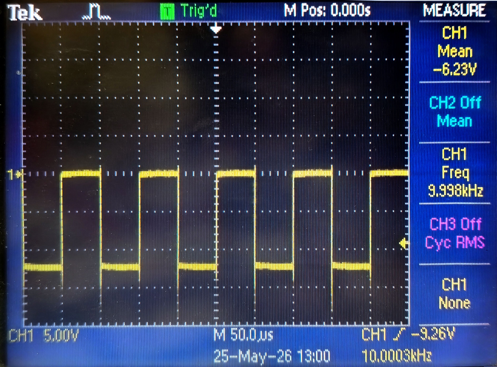
</p>

### 2. Output DC Voltage Ripple & Mean Stability
Verification of the output DC bus stability and low-frequency ripple suppression under active closed-loop switching:

<p align="center">
  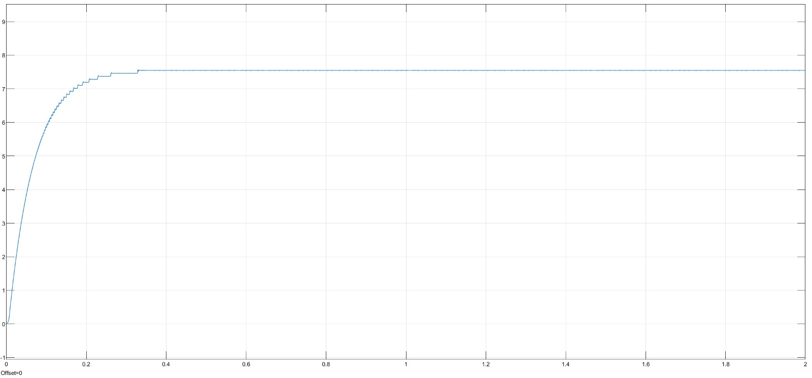
</p>

### 3. Real-Time Hardware Testing Bench
Active laboratory validation demonstrating closed-loop regulation tracking the setpoint on the digital multimeter:

<p align="center">
  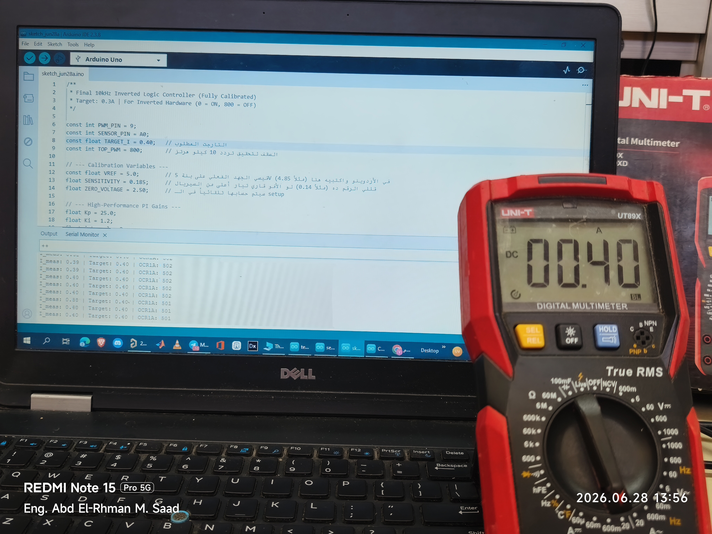
</p>

### 4. Arduino Serial Monitor Telemetry Log
Serial telemetry capturing dynamic current regulation tracking target setpoints:

<p align="center">
  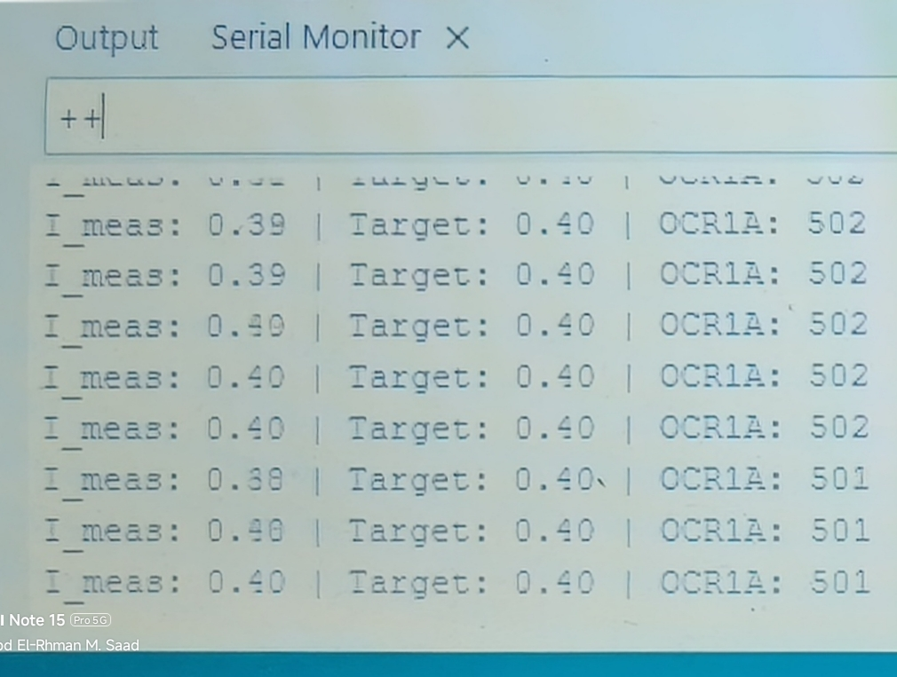
</p>

---

### Experimental Current Step Response Verification

As documented in Table 6.1 of the graduation thesis, the closed-loop controller was tested across four distinct current setpoints. The experimental multimeter readings confirm tight closed-loop tracking with steady-state error bounded strictly **within 5.0%** across the entire operating range:

| Current Setpoint ($I_{\text{ref}}$) | Experimental Reading ($I_{\text{meas}}$) | Absolute Error ($\Delta I$) | Relative Steady-State Error | Hardware Operational Finding |
| :---: | :---: | :---: | :---: | :--- |
| **$0.30\text{ A}$** | **$0.29\text{ A}$** | $-0.01\text{ A}$ | **$-3.3\%$** | Stable tracking; low sensor SNR at lower bounds |
| **$0.40\text{ A}$** | **$0.38\text{ A}$** | $-0.02\text{ A}$ | **$-5.0\%$** | Nominal setpoint; within thesis Table 6.1 boundary |
| **$0.50\text{ A}$** | **$0.48\text{ A}$** | $-0.02\text{ A}$ | **$-4.0\%$** | Linear response; zero thermal drift observed |
| **$0.60\text{ A}$** | **$0.58\text{ A}$** | $-0.02\text{ A}$ | **$-3.3\%$** | High-current ceiling; heatsink temperature $< 38^{\circ}\text{C}$ |

### Multimeter Measurement Gallery

<p align="center">
  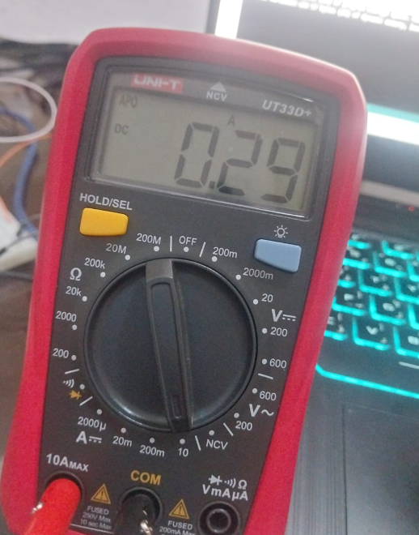
  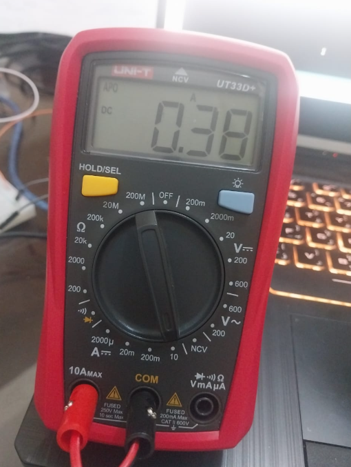
</p>
<p align="center">
  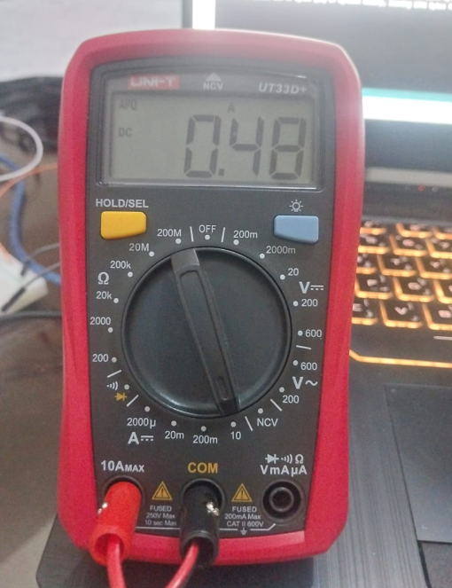
  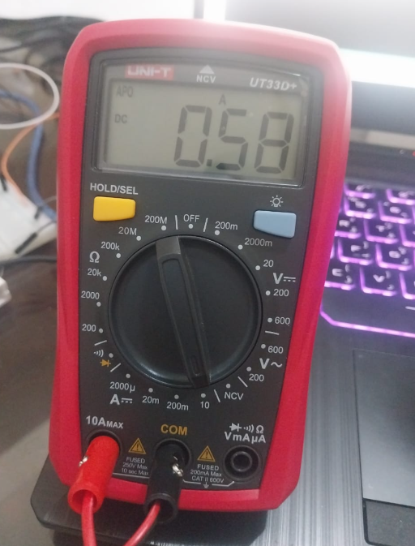
</p>

---

## 📂 Directory Structure & Hardware Replication Guide

```text
5_Hardware_and_PCB_Design/
├── README.md                                          # Master hardware & experimental report
├── Two_Quadrant_Chopper.zip                           # Full Altium project (Schematic, PCB, Gerbers)
├── Buck_Converter.zip                                 # Full Altium project for synchronous buck stage
├── Interleaved_Thevenin.zip                           # Full Altium project for interleaved boost stage
└── images/                                            # 300 DPI high-resolution experimental photographs
    ├── all_hardware_system.png
    ├── bench_closed_loop_test.jpg
    ├── pcb_3d_isometric.png
    ├── pcb_actual_board.jpg
    ├── reading_0_3A.png
    ├── reading_0_4A.png
    ├── reading_0_5A.png
    ├── reading_0_6A.png
    ├── schematic.png
    ├── serial_monitor.jpg
    ├── voltage_scope.jpeg
    └── waveform_gate.jpg
```

### Steps for Hardware Replication

1. **Bare Board Fabrication:**
   * Extract `Two_Quadrant_Chopper.zip`.
   * Submit the generated Gerber files (`.GTL`, `.GBL`, `.GTO`, `.GBO`, `.GTS`, `.GBS`) and NC Drill file (`.TXT`) to any standard 2-layer PCB manufacturer (JLCPCB / PCBWay).
   * Specify **$1.6\text{ mm}$ FR-4 thickness, $1\text{ oz}$ outer copper weight, HASL with lead finish**.
2. **Component Assembly:**
   * Solder low-profile passive components first (resistors, diodes), followed by DIP IC sockets, terminal blocks, electrolytic capacitors, and TO-247 power MOSFETs.
   * Apply thermal interface grease and mount the TO-247 packages securely to aluminum heatsinks before electrical energization.
3. **Firmware Upload:**
   * Open `sketch_jun28a.ino` in the Arduino IDE.
   * Select board: **Arduino Uno**; Programmer: **AVRISP mkII**.
   * Compile and flash the firmware over USB.
4. **Initial Power-Up Protocol:**
   * Connect an auxiliary $12.0\text{ V}$ isolated DC supply to terminal $J_1$ (Gate Driver VCC).
   * Verify gate pulses at pin 7 (HO) and pin 5 (LO) on an oscilloscope before connecting the high-voltage/battery bus.
