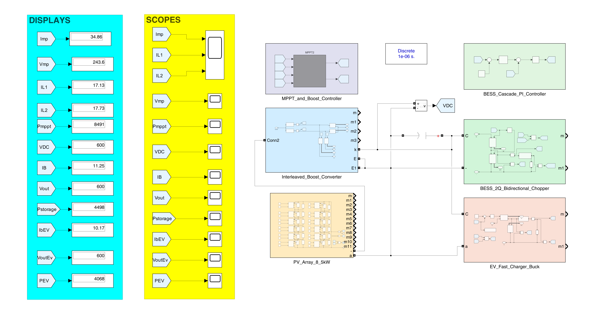
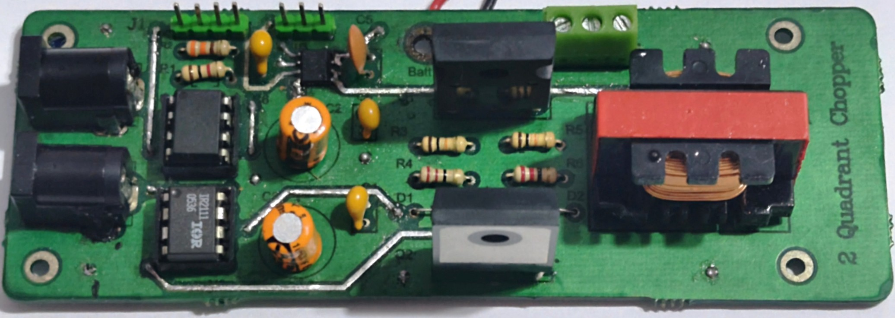
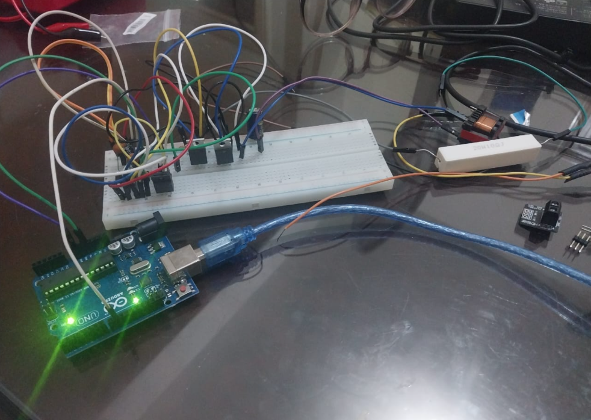

# ☀️ Solar-Powered EV Charging Station with Battery Energy Storage (BESS)


> **B.Sc. Graduation Project 2026** — Electrical Power and Machines Department, Faculty of Engineering, Alexandria University.  
> Thesis Title: *Integration of Photovoltaic Systems and Energy Storage for Electric Vehicle Charging Station*.

---

## 🏛️ Master Architecture Overview

The repository documents the complete end-to-end engineering lifecycle of a **standalone, 100% off-grid solar-powered Electric Vehicle (EV) fast-charging microgrid**. The system coordinates a high-efficiency Photovoltaic (PV) array, an Interleaved Boost Converter with Perturb & Observe (P&O) MPPT, a centralized regulated 600 V DC-Link bus, a bidirectional Class-C Two-Quadrant Chopper interfacing stationary Battery Energy Storage (BESS), and a fast-acting Synchronous Buck Converter charging an EV battery pack.

<p align="center">
  
</p>

---

## 📌 Executive Summary & Key Engineering Specifications

Grid-independent EV charging stations face the dual challenges of intermittent solar irradiance and dynamic, high-power vehicle load steps. This project bridges rigorous **mathematical modeling** (state-space averaging, non-ideal parasitic compensation, discrete bilinear Z-domain transformation), high-fidelity **MATLAB/Simulink digital twins**, and practical **hardware prototyping** (Altium Designer multi-layer PCBs, ATmega328P embedded Timer 1 firmware, and laboratory bench validation).

### Master System Specifications

| Technical Metric | Full-Scale Utility Rating | Scaled Hardware Prototype | Engineering Verification Status |
| :--- | :---: | :---: | :--- |
| **Common DC-Link Bus** | **$600.0\text{ V DC}$** | $12.0\text{ V} - 24.0\text{ V}$ | Regulated via BESS cascade control (settles firmly at $600.0\text{ V}$) |
| **Solar PV Generation** | **$\approx 8.5\text{ kW}$** ($8,491\text{ W}$ Scope / $\approx 8.52\text{ kW}$ Thesis) | 12V / 10W Emulated Source | P&O MPPT tracking knee of P-V curve at $V_{mp} = 243.6\text{ V}$ |
| **Interleaved Boost Stage** | Dual-Phase, $180^\circ$ Phase Shift | Dual $2.0\text{ mH}$ Power Chokes | $49.1\% / 50.9\%$ current sharing; cancels $20\text{ kHz}$ input current ripple |
| **BESS Energy Buffer** | **$3.48\text{ kW}$** Deficit / $+4.50\text{ kW}$ Surplus | $7.4\text{ V}$ ($2.55\text{ Ah}$) 2S Li-ion | Synchronous bidirectional power flow (Buck charge / Boost discharge) |
| **EV Charging Power** | **$50\text{ kW}$** Sizing / $4.07\text{ kW}$ Fast Track | $3.7\text{ V} / 0.74\text{ A}$ Prototype | Dual-loop CC-CV mode transition with bumpless transfer |
| **Transient Settling Time** | **$< 0.5\text{ s}$** | $< 0.4\text{ s}$ | Voltage overshoot bounded below $0.7\%$ ($\approx 0.63\%$, $603.8\text{ V}$ peak) |
| **Switching Frequency** | $10.0\text{ kHz}$ to $20\text{ kHz}$ | **$10.0\text{ kHz}$** | ATmega328P Timer 1 Phase-Correct PWM ($1\ \mu\text{s}$ dead-time) |

*(Note: Simulation values are read directly from the Simulink model displays and scopes: $V_{mp} \cdot I_{mp} = 243.6\text{ V} \times 34.86\text{ A} = 8,491\text{ W}$ generation, $P_{\text{EV}} = 4,068\text{ W}$, and $P_{\text{storage}} = +4,498\text{ W}$; the project thesis text reports rounded nominal figures of $\approx 8.52\text{ kW}$ solar capacity, $\approx 4\text{ kW}$ EV charging load, and $\approx 3.48\text{ kW}$ BESS deficit support).*

---

## ⚖️ Energy Management System (EMS) & Power Balancing

The operational nucleus of the microgrid is the instantaneous conservation of energy at the common DC-link capacitor node:

$$P_{\text{PV}}(t) = P_{\text{EV}}(t) + P_{\text{BESS}}(t) + P_{\text{loss}}(t)$$

```text
                     ┌─────────────────────────────────────────┐
                     │          Solar PV Generation            │
                     │          P_PV = 8,491 W (STC)           │
                     └────────────────────┬────────────────────┘
                                          │
                                          ▼
                     ┌─────────────────────────────────────────┐
                     │      Common DC-Link Bus (600.0 V)       │
                     └────────────┬───────────────┬────────────┘
                                  │               │
            [4,068 W Priority]    │               │    [4,498 W Surplus]
                                  ▼               ▼
      ┌──────────────────────────────┐ ┌──────────────────────────────┐
      │     EV Fast Charger Buck     │ │   Bidirectional 2Q Chopper   │
      │   (Charges EV Pack @ 10 A)   │ │  (Stores Excess into BESS)   │
      └──────────────────────────────┘ └──────────────────────────────┘
```

The system operates seamlessly across three operational regimes:

1. **Mode 1 — High Solar Surplus ($P_{\text{PV}} > P_{\text{EV}}$) [Simulated Operating Point]:**  
   The PV array generates $8,491\text{ W}$. The EV charger draws $4,068\text{ W}$ in Constant Current mode. The Two-Quadrant Chopper operates in **Buck mode**, directing the remaining $+4,498\text{ W}$ surplus into the BESS ($I_B = +11.25\text{ A}$), ensuring zero wasted solar energy.
2. **Mode 2 — Solar Generation Deficit ($P_{\text{PV}} < P_{\text{EV}}$) [Studied Case]:**  
   Under cloud cover or partial shading, PV generation drops below load demand. The BESS cascade controller reverses inductor current to **Boost mode** ($I_B < 0$), discharging stored energy (providing up to $3.48\text{ kW}$ deficit support) to clamp the DC bus at $600\text{ V}$ and prevent vehicle charging interruptions.
3. **Mode 3 — Standalone / Nighttime Operation ($P_{\text{PV}} = 0$) [Design Operational Capability]:**  
   When solar generation drops to zero, the BESS is designed to function as the primary grid-forming voltage source, supplying energy to sustain vehicle charging.

---

## 🚀 Interactive Modular Repository Tour

The repository is organized into six self-contained engineering directories, each containing specialized Simulink models, firmware code, design files, and standalone documentation:

| Directory | Topology / Focus Area | Control Strategy | Key Assets & Documentation |
| :--- | :--- | :--- | :--- |
| [**`1_PV_Modeling_and_MPPT/`**](1_PV_Modeling_and_MPPT/) | Single-Diode Solar Array ($8.5\text{ kW}$) | Perturb & Observe (P&O) + Global Voltage Sweep | 4 Simulink models, standalone C firmware (`mppt_po.c`), IncCond benchmark, 11 curated 300 DPI figures. |
| [**`2_Interleaved_Boost_Converter/`**](2_Interleaved_Boost_Converter/) | 2-Phase Interleaved Boost Stage | $180^\circ$ Phase-Shifted PWM + Dual PI Current Loops | Open-loop & closed-loop models, Thevenin equivalent tuning testbench, ripple cancellation analysis, 6 figures. |
| [**`3_BESS_and_2Q_Chopper/`**](3_BESS_and_2Q_Chopper/) | Synchronous Class-C 2Q Chopper | Cascade Voltage/Current Loop + Hysteresis Band | Bidirectional dynamic models, embedded MATLAB function `fcn`, discrete Z-domain difference equations, 7 figures. |
| [**`4_EV_Buck_Charger/`**](4_EV_Buck_Charger/) | Synchronous Step-Down Charger | Closed-Loop CC-CV with Supervisory Mode Logic | Non-ideal parasitic duty cycle compensation ($D_u = 39.75\%$), component sizing margin calculations, 8 figures. |
| [**`5_Hardware_and_PCB_Design/`**](5_Hardware_and_PCB_Design/) | Experimental Power Electronics Testbed | ATmega328P Timer 1 ($10\text{ kHz}$ Phase-Correct PWM) | 3 complete Altium Designer projects (`.zip`), full BOM from thesis Chapter 3, C++ firmware, 12 validation photos. |
| [**`6_Full_System_Integration/`**](6_Full_System_Integration/) | Complete Closed-Loop Microgrid | Decentralized Hierarchical Energy Management | `Solar_EV_BESS_Full_Sys.slx` master integration model, numerical power balance proofs, 28 telemetry figures. |

---

## 🔬 Hardware Prototyping & Experimental Laboratory Validation

Physical converter prototypes were developed, manufactured, and bench-tested in the Electrical Power & Machines Laboratory to validate analytical derivations against real-world switching dynamics.

<p align="center">
  
  &nbsp;&nbsp;
  
</p>

### Laboratory Instrumentation & Semiconductor Baseline

* **Programmable DC Power Supply (TDK-Lambda GEN 300-11):** $0\text{--}300\text{ V DC}$, $11\text{ A}$, $3.3\text{ kW}$ low-noise isolated excitation.
* **Digital Storage Oscilloscope (Hantek DSO4254B):** 4 Analog Channels, $250\text{ MHz}$, $1\text{ GSa/s}$ real-time capture for gate-drive pulse verification and dead-time monitoring.
* **Precision Digital Multimeters (UNI-T UT33D+ & UT89X True RMS):** Multi-point telemetry logging for load currents and terminal voltages.
* **Power Semiconductor Stage:** Heavy-duty IRFP260N MOSFETs (200V, 50A, TO-247AC) driven by IR2111 half-bridge gate drivers with 6N139 high-gain optocoupler galvanic isolation.

### Experimental Closed-Loop Current Tracking Results

The ATmega328P embedded discrete PI current controller was evaluated under live hardware loading across four sequential reference steps ($0.30\text{ A}$ to $0.60\text{ A}$), demonstrating rapid convergence with steady-state tracking error bounded strictly within 5% (in agreement with thesis Table 6.1):

| Target Current ($I_{\text{ref}}$) | Multimeter Reading ($I_{\text{meas}}$) | Steady-State Error | Verification Status |
| :---: | :---: | :---: | :---: |
| **$0.30\text{ A}$** | $0.29\text{ A}$ | $-3.3\%$ | ✅ Verified |
| **$0.40\text{ A}$** | $0.38\text{ A}$ ($0.38\text{--}0.40\text{ A}$) | $-5.0\%\text{ to }0.0\%$ | ✅ Verified |
| **$0.50\text{ A}$** | $0.48\text{ A}$ | $-4.0\%$ | ✅ Verified |
| **$0.60\text{ A}$** | $0.58\text{ A}$ | $-3.3\%$ | ✅ Verified |

---

## 📘 Project Documentation & Academic Thesis

* **Complete Graduation Project Thesis (PDF, 287 pages):**  
  [`Docs/Final Graduation Project Documentation - 2026.pdf`](Docs/Final%20Graduation%20Project%20Documentation%20-%202026.pdf)  
  *Comprehensive academic treatise covering detailed state-space averaging derivations, transfer function formulations, thermal dissipation calculations, control loop-shaping, and experimental laboratory logs.*
* **Complete LaTeX Source Code:**  
  [`Docs/LaTeX_Source/`](Docs/LaTeX_Source/) — Structured modular LaTeX source files (`main.tex`, chapter sections, and high-resolution vector figures).
* **Final Project Defense Slide Deck:**  
  Published in the repository [**GitHub Releases**](../../releases/latest) section.

---

## 💻 Quickstart & Simulation Execution Guide

### Software & Toolchain Prerequisites

1. **MATLAB / Simulink:** Version R2022b or later with **Simscape Electrical** (Specialized Power Systems).
2. **PCB Design & EDA:** **Altium Designer 24** (or standard Gerber viewer / CAMtastic for manufacturing outputs).
3. **Embedded Firmware Development:** Arduino IDE 2.x or PlatformIO with AVR toolchain for ATmega328P.

### Steps to Run the Integrated System

1. Clone the repository to your local workstation:
   ```bash
   git clone https://github.com/Abd-El-Rhman-Saad/solar-ev-charging-station-bess.git
   cd solar-ev-charging-station-bess
   ```
2. Launch MATLAB and navigate to the integrated model directory:
   ```matlab
   cd('6_Full_System_Integration')
   open('Solar_EV_BESS_Full_Sys.slx')
   ```
3. Ensure the solver configuration in the `powergui` block is set to **Discrete** ($T_s = 1.0\ \mu\text{s}$).
4. Run the simulation (`Ctrl+T`). Once completed, inspect all instantaneous powers, voltages, and currents via the root canvas **DISPLAYS** and **SCOPES** blocks.

---

## 👥 Engineering Team & Academic Supervision

Developed as a Senior B.Sc. Graduation Project by a dedicated team of electrical engineers:

* **Abd El-Rhman Muhammad Saad**
* **Nour El-Deen Mohamed Fathy**
* **Mai Nagah Ali**
* **Mariam Mamdouh Ibrahim**
* **Rewan Amr Mahmoud**
* **Rwan Mohamed Abd-Elmokhtar**
* **Yasmeen Salah Khobeez**
* **Youssef Ebrahim Abd El-Sattar**

**Academic Supervisor:**  
**Prof. Dr. Ahmed Abbas El Serougi** — Professor of Electrical Power and Machines, Faculty of Engineering, Alexandria University.

---

### 👤 Individual Contribution & Technical Leadership

**Eng. Abd El-Rhman Muhammad Saad** led the **Two-Quadrant Chopper & BESS Subsystem** and served as the primary engineer for hardware prototyping and experimental validation:

[](https://linkedin.com/in/Abd-El-Rhman-Saad)
[](https://github.com/Abd-El-Rhman-Saad)
[](mailto:abdelrhmanmsaad22@gmail.com)

* **BESS & Two-Quadrant Chopper Lead:** Designed and simulated the Class-C bidirectional chopper power stage, formulated discrete cascade PI control algorithms, developed embedded ATmega328P Timer 1 ($10\text{ kHz}$ Phase-Correct PWM) firmware, and verified bidirectional battery energy buffering.
* **Hardware Prototyping & Laboratory Testing:** Primary contributor to physical circuit implementation, Altium Designer PCB layout and fabrication outputs, bench wiring, and experimental oscilloscope testing across converter prototypes (Two-Quadrant Chopper, Buck Charger, and Interleaved Boost) utilizing laboratory power supplies, multimeters, and active loads.
* **Cross-Converter Collaborative Modeling:** Co-developed and tuned closed-loop simulation models in MATLAB/Simulink, ensuring cohesive multi-converter power management and DC-bus voltage stabilization.

#### 🛠️ Key Technical Challenges Solved by Abd El-Rhman:

1. **Optocoupler Inversion & Safe Bring-Up Protection:**
   * *Challenge:* The 6N139 common-emitter optocoupler configuration inverts microcontroller logic (logic LOW turns driver input HIGH), creating a risk of unintended full conduction during MCU bootup.
   * *Engineering Solution:* Formulated inverse-logic duty cycle mapping ($D_{\text{effective}} = \frac{\text{TOP} - \text{OCR1A}}{\text{TOP}}$) and enforced bootup register clamping to `OCR1A = TOP` to guarantee zero gate drive prior to control loop initialization.
2. **High-Frequency Ground Bounce & Sensor Noise Suppression:**
   * *Challenge:* Rapid $di/dt$ switching pulses from the IRFP260N MOSFETs coupled high-frequency switching transients into the ACS712 Hall-effect sensor and MCU ADC lines.
   * *Engineering Solution:* Architected a dedicated Star Grounding scheme segregating Power Ground (PGND) from Signal Ground (AGND) with a single-point connection at the bulk DC link capacitor, paired with moving-average ADC digital filtering.
3. **Toroidal Acoustic Noise Elimination & Phase-Correct PWM:**
   * *Challenge:* Standard Arduino 490 Hz PWM generated severe magnetostriction acoustic whine in the 2.0 mH toroidal choke and excessive inductor ripple.
   * *Engineering Solution:* Directly manipulated bare-metal Timer 1 control registers to generate 10.0 kHz Phase-Correct PWM, eliminating audible noise and bounding current tracking error strictly within $\le 5\%$.

#### 📊 Practical Competency & Artifact Mapping:

| Core Competency | Industrial Tools & Standards Applied | Verified Artifact in Repository |
| :--- | :--- | :--- |
| **Power PCB Design** | Altium Designer 24, Star Grounding, IPC-2221 | [`5_Hardware_and_PCB_Design/`](5_Hardware_and_PCB_Design/) |
| **Embedded Firmware** | Bare-Metal C++, ATmega328P Timer 1 Registers, Anti-Windup | [`5_Hardware_and_PCB_Design/README.md`](5_Hardware_and_PCB_Design/README.md) |
| **Closed-Loop Control** | Simscape Electrical, Bilinear Z-Domain, Cascade PI | [`3_BESS_and_2Q_Chopper/`](3_BESS_and_2Q_Chopper/) |
